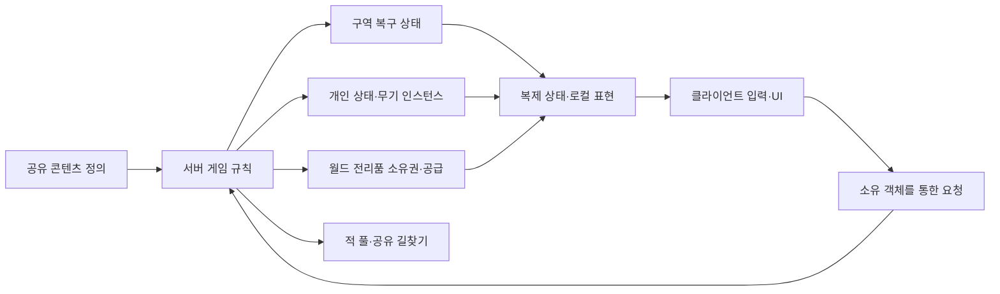

# ART: Arcade Reclamation Team · Gameplay Programming Portfolio

**Unreal Engine 5.8로 만든 1~4인 협동 FPS 로그라이트 호드 슈터** (개발 코드명 FPSRoguelite)

오염된 픽셀 아케이드 세계에 투입된 복구팀이 되어, 오염된 구역을 하나씩 되찾으며 몰려오는 적을 막고 20:00에 나타나는 최종 보스를 처치하는 게임입니다. **2026-10-23 공개 데모를 완성했으며 Steam 스토어 페이지는 심사 중입니다.** 데모 한 판은 런 시작 → 전투·파밍·무기 성장 → 20:00 최종 보스 → 승리/패배 → 결산으로 이어지며 솔로부터 4인 협동까지 지원합니다.

**개인 프로젝트의 프로그래밍 담당**으로 게임 제약에 맞는 설계 판단, C++ 구현 통합, 데이터·UI 연결과 검증을 수행합니다. 다수의 적을 위한 공유 길찾기·풀링, 서버가 판정하는 구역 복구, 무기 인스턴스 성장과 공급, 전투 이벤트, 복제를 늘리지 않는 관전 표현을 프로젝트에 맞게 구현하고, 엔진 코드까지 추적해 실제 플레이 결함을 해결한 과정을 소개합니다.

개발 과정에는 AI 에이전트의 구현·검토 지원을 사용합니다. 작업 범위와 게임 규칙의 결정, 변경 통합, 검증 결과의 판단과 실제 플레이 확인은 프로젝트 담당자의 책임으로 운영합니다.

`C++` · `Gameplay Ability System` · `Server Authority` · `Push Model` · `Flow Field` · `Data Assets` · `CommonUI` · `Automation Framework`

**기준일: 2026-10-23.** 문서와 다이어그램을 공개하는 프로그래밍 포트폴리오입니다. [제작·공개 범위](NOTICE.md) · [구현 현황](docs/08-current-state.md) · [검증 근거](docs/05-verification.md)

## 먼저 볼 세 가지 사례

| 사례 | 대표 결과와 읽을 지점 |
|---|---|
| [1. 낙하 경계에서 슬라이드가 멈추는 결함 해결](docs/10-debugging-case.md) | 진입 각도에 따른 증상을 엔진의 앉기·낙하 분기로 설명하고 기존 설정 변경으로 해결. 당시 풀 리빌드·자동화 58/58과 사용자 PIE 네 가지 동작 확인 |
| [2. 다수의 적을 위한 공유 길찾기와 풀](docs/02-swarm-pathfinding.md) | 높이 표면·단방향 낙하를 공유 거리장에 반영하고 정확한 클래스별 풀로 재사용. 과거 패키지 측정에서 약 890마리 조건의 솔로/로컬 4인 호스트 비용을 비교해 CPU 병목 확인 |
| [3. 구역 복구 체인과 서버 권위 상태](docs/03-zone-restoration.md) | 런의 1차 목표를 서버 판정·로컬 표현으로 나눠 구현. 멀티플레이에서만 보이던 구역 색 깜빡임을 "상태를 안다"와 "런이 시작됐다"의 분리로 해결하고 독립 검토·자동화 58/58·사용자 멀티 확인 |

이동 사례는 **문제 재현과 원인 추적**, 스웜 사례는 **반복 비용과 측정 해석**, 구역 사례는 **서버 상태와 표현의 경계**를 중심으로 읽을 수 있습니다.

## 이어서 볼 구현 사례

| 문제 | 프로젝트의 선택 | 상세 |
|---|---|---|
| 화폐 없이 전투만으로 무기가 강해지게 하려면? | 피해를 낸 무기 인스턴스에 경험치 귀속, 5레벨마다 서버가 Perk 자동 장착, 처치·구역 복구·미션이 곧 무기 공급 | [무기 성장](docs/04-card-weapon-design.md) |
| 연쇄 효과가 폭주하거나 재사용된 적에게 적용되는 것을 어떻게 막을까? | 이벤트 계보, 세대 제한, 수명 식별, 소유자별 큐와 작업 예산 | [전투 이벤트](docs/07-combat-events.md) |
| 조작·화면이 네트워크 판정을 침범하지 않게 하려면? | 엔진 이동 예측 확장, 프록시 표현, 로비 확정 선택과 로컬 미리보기 분리 | [예측 이동](docs/09-movement-lobby-ui.md) |
| 쓰러진 플레이어가 아군을 1인칭으로 보게 하면서 복제를 늘리지 않으려면? | 대상 전환만 서버 검증, 팔·무기·탄 표현은 기존 복제 상태로 로컬 재생 | [다운 관전](docs/11-spectate-network-presentation.md) |

[아키텍처](docs/01-architecture.md) · [설계 선택과 비용](docs/06-design-decisions.md)

## 게임의 설계 전제

- 한 판은 한 아레나입니다. **20:00에 최종 보스가 등장**하며 보스 처치가 승리입니다. 20:00은 강제 종료가 아니고 이후 압박이 계속 증가합니다. 데모는 0~6분·6~14분·14~20분의 3막으로 압박을 나눕니다.
- 런의 1차 목표는 **구역 복구**입니다. 맵은 약 60m 타일 구역의 조합이며, 복구 장치로 오염 구역을 되찾아 보스전 공간을 넓힙니다. 적은 오염 구역에서 나옵니다.
- 직접 조준, 약점, 반동, 슬라이드와 이동이 전투의 중심입니다. 기본 점프는 한 번이며 추가 공중 점프는 Combat Item입니다.
- 일반 적은 경량 체력·풀 액터·공유 Flow Field를 사용하고 외형은 방향별 픽셀 스프라이트입니다. GAS(Gameplay Ability System: 능력·효과 프레임워크)의 적용 범위는 플레이어·엘리트·보스입니다.
- **적 1000+는 스트레스 목표**입니다. 실제 동시 수는 Director와 성능 예산에 따라 달라집니다. 해당 부하의 성능 달성을 주장하지 않습니다.
- 성장의 중심은 무기입니다. 무기는 그 무기로 준 피해만큼 레벨이 오르고(WSU: Weapon Stat Upgrade), 5레벨마다 해당 무기의 행동을 바꾸는 Perk가 붙습니다. Combat Item은 무기 교체 후에도 유지되는 플레이어 빌드 아이템입니다.
- 무기와 아이템은 처치·구역 복구·비행 표적 미션에서 공유 실물로 떨어집니다. 코인·자판기·상점·Recycler, 화면형 카드 상점, XP와 파티 레벨은 데모 전에 게임 규칙에서 제거했습니다.

## 제작 경계

엔진의 Gameplay Ability System(GAS: 능력·효과 프레임워크), CharacterMovementComponent(CMC: 캐릭터 이동·네트워크 예측), 복제와 CommonUI를 기반으로 사용합니다. 공유 탐색, 클래스별 적 풀, 구역 복구 상태, 전리품 정본·공급과 전투 이벤트의 수명·예산 관리, 관전 표현은 프로젝트의 구현 영역입니다. 외부 반동·무기 표현 솔루션과 구매 에셋은 기반 기술·콘텐츠로 사용하며 해당 제품의 제작을 개인 성과에 포함하지 않습니다. 소스 코드·코드 발췌·실행 파일·구매 에셋은 공개하지 않습니다.

각 사례는 설계 승인, 코드 구현, 실행 검증과 미검증 범위를 구분해 적었습니다. 데모 완성은 기능 범위의 완성을 뜻하며, 4인 원격 네트워크·장시간 성능처럼 기록이 없는 항목은 [현황표](docs/08-current-state.md)와 [검증 문서](docs/05-verification.md)에 남은 범위로 표시했습니다.

**English overview:** A documentation-only programming portfolio for *ART: Arcade Reclamation Team* (codename FPSRoguelite), an Unreal Engine 1-4 player co-op FPS roguelite horde shooter. The public demo was completed on 2026-10-23; the Steam store page is under review. Case studies cover shared navigation and enemy pooling, server-authoritative zone restoration, weapon-instance growth and currency-free supply, bounded combat events, predicted movement, and non-replicated first-person spectating. Design, implementation and verified behavior are distinguished explicitly. No source code or assets are distributed.
