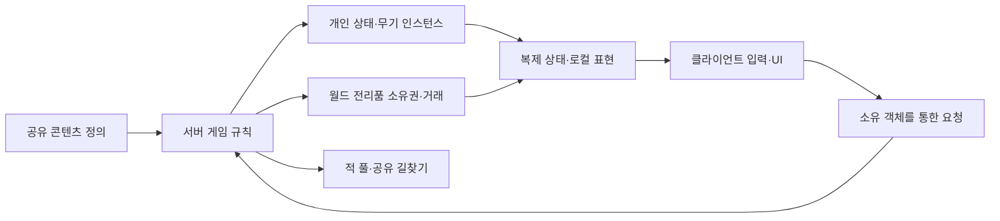

# FPSRoguelite · Gameplay Programming Portfolio

**Unreal Engine 5.8로 만드는 1~4인 협동 FPS 로그라이트 호드 슈터**

많은 적이 같은 전장을 공유하는 상황에서 사격, 이동, 전리품 교환과 빌드 성장을 함께 운영하는 프로젝트입니다. 이 포트폴리오는 **반복 계산의 비용, 서버의 상태 변경, 런타임 객체의 수명**을 어떻게 나누었는지 설명합니다. 각 사례에는 설계 이유와 구현 경계, 확인한 범위와 남은 검증을 함께 적었습니다.

`C++` · `Gameplay Ability System` · `Server Authority` · `Push Model` · `Flow Field` · `Data Assets` · `CommonUI` · `Automation Framework`

> 문서와 다이어그램만 공개합니다. 소스 코드·코드 발췌·실행 파일·구매 에셋은 포함하지 않습니다. **기준일: 2026-10-12.** 현재 비공개 개발 작업 트리의 미커밋 구현도 설명하므로 코드 작성과 실행 검증을 구분해서 읽어 주세요. [현재 상태](docs/08-current-state.md) · [검증 범위](docs/05-verification.md)

## 주요 프로그래밍 사례

| 문제 | 프로젝트의 선택 | 상세 |
|---|---|---|
| 다수의 적이 소수의 플레이어를 추적할 때 계산을 어떻게 공유할까? | 높이 표면 그래프, 다중 시작점 BFS, 낙하의 역방향 연결, 정확한 클래스별 풀 | [적 스웜·길찾기](docs/02-swarm-pathfinding.md) |
| 줍기·교체·구매 중 상태가 바뀌면 소유권과 재화를 어떻게 보존할까? | 자산 ID와 revision, 예약·준비·커밋, 서버 견적과 재전송 영수증 | [전리품·월드 거래](docs/03-authoritative-shop.md) |
| 무기 투자와 플레이어 빌드가 섞이지 않게 하려면? | 정의·인스턴스 분리, 무기 WSU·Perk와 플레이어 Combat Item의 책임 분리 | [무기 성장](docs/04-card-weapon-design.md) |
| 연쇄 효과가 폭주하거나 재사용된 적에게 적용되는 것을 어떻게 막을까? | 이벤트 계보, 세대 제한, 수명 식별, 소유자별 큐와 작업 예산 | [전투 이벤트](docs/07-combat-events.md) |
| 조작·화면이 네트워크 판정을 침범하지 않게 하려면? | CMC 예측 확장, 프록시 표현, 로비 확정 선택과 로컬 미리보기 분리 | [이동·협동 UI](docs/09-movement-lobby-ui.md) |

[아키텍처](docs/01-architecture.md) · [설계 선택과 비용](docs/06-design-decisions.md)

## 게임의 설계 전제

- 한 판은 한 아레나입니다. **제품 목표는 20:00 최종 보스 등장**이며 보스 처치가 승리입니다. 20:00은 강제 종료가 아니고 이후 압박이 증가합니다. 10분 프로필은 개발 검증용입니다.
- 직접 조준, 약점, 반동, 슬라이드와 이동이 전투의 중심입니다. 설계상 기본 점프는 한 번이며 추가 공중 점프는 Combat Item입니다.
- 일반 적은 경량 체력·풀 액터·공유 Flow Field를 사용합니다. GAS의 적용 범위는 플레이어·엘리트·보스입니다.
- **적 1000+는 스트레스 목표**입니다. 실제 동시 수는 Director와 성능 예산에 따라 달라집니다. 해당 부하의 성능 달성을 주장하지 않습니다.
- 성장의 중심은 월드 전리품, 무기 WSU·Perk와 Combat Item입니다. 화면형 카드 3택1 상점, XP와 파티 레벨은 현재 성장 규칙에서 제거되었습니다.
- 최신 승인 경제는 공용 Coin 획득 시 참가자 각각 동액 지급, 개인 WSU, Stock/WSU/Recycler입니다. 각 경로의 구현 상태는 [현황표](docs/08-current-state.md)에서 구분합니다.

## 제작 경계

프로그래밍 작업은 게임 규칙, 경량 적 운영, 전리품 거래, 무기 상태·전투 이벤트, 데이터 검증과 UI 연결을 다룹니다. 엔진의 GAS·CMC·복제·CommonUI 및 외부 반동·무기 표현 솔루션은 기반 기술로 사용합니다. 외부 제품 자체를 직접 제작한 성과로 소개하지 않습니다. [공개 범위 및 권리 고지](NOTICE.md)

**English overview:** A documentation-only programming portfolio for an Unreal Engine cooperative FPS roguelite horde shooter. Case studies cover shared navigation, enemy pooling, authoritative loot and vending transactions, weapon-instance growth, bounded combat events, predicted movement and UI. Current design, committed implementation, uncommitted work and verified behavior are distinguished explicitly. No source code or assets are distributed.
