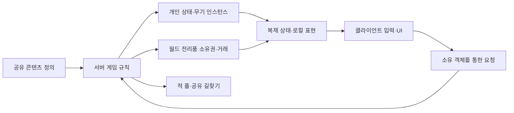

# FPSRoguelite · Gameplay Programming Portfolio

**Unreal Engine 5.8로 만드는 1~4인 협동 FPS 로그라이트 호드 슈터**

**개인 프로젝트의 프로그래밍 담당**으로 게임 제약에 맞는 설계 판단, C++ 구현 통합, 데이터·UI 연결과 검증을 수행합니다. 다수의 적을 위한 공유 길찾기·풀링, 서버 전리품 소유권, 무기 인스턴스와 전투 이벤트를 프로젝트에 맞게 구현하고, 엔진 이동 코드까지 추적해 실제 플레이 결함을 해결한 과정을 소개합니다.

개발 과정에는 AI 에이전트의 구현·검토 지원을 사용합니다. 작업 범위와 게임 규칙의 결정, 변경 통합, 검증 결과의 판단과 실제 플레이 확인은 프로젝트 담당자의 책임으로 운영합니다.

`C++` · `Gameplay Ability System` · `Server Authority` · `Push Model` · `Flow Field` · `Data Assets` · `CommonUI` · `Automation Framework`

**기준일: 2026-10-12.** 문서와 다이어그램을 공개하는 프로그래밍 포트폴리오입니다. [제작·공개 범위](NOTICE.md) · [구현 현황](docs/08-current-state.md) · [검증 근거](docs/05-verification.md)

## 먼저 볼 세 가지 사례

| 사례 | 대표 결과와 읽을 지점 |
|---|---|
| [1. 낙하 경계에서 슬라이드가 멈추는 결함 해결](docs/10-debugging-case.md) | 진입 각도에 따른 증상을 엔진의 앉기·낙하 분기로 설명하고 기존 설정 변경으로 해결. 당시 풀 리빌드·자동화 58/58과 사용자 PIE 네 가지 동작 확인 |
| [2. 다수의 적을 위한 공유 길찾기와 풀](docs/02-swarm-pathfinding.md) | 높이 표면·단방향 낙하를 공유 거리장에 반영하고 정확한 클래스별 풀로 재사용. 과거 패키지 측정에서 약 890마리 조건의 솔로/로컬 4인 호스트 비용을 비교해 CPU 병목 확인 |
| [3. 전리품 소유권과 서버 거래](docs/03-authoritative-shop.md) | 자산의 정체성·변경 버전과 준비→커밋 경계로 교환 실패·중복 요청을 다룸. 기존 전리품 기반과 최신 무기 스탯 강화(WSU) 구매 구현의 검증 범위를 구분 |

이동 사례는 **문제 재현과 원인 추적**, 스웜 사례는 **반복 비용과 측정 해석**, 거래 사례는 **상태 일관성과 실패 경로**를 중심으로 읽을 수 있습니다. 2026-10-11 전리품 기본 전환·XP 제거 시점에는 빌드 3종과 제품 드롭 풀 2인 지급 시험 3/3을 확인했습니다. 전체 자동화는 772건 중 770건 성공이며 기존 실패 2건은 [검증 문서](docs/05-verification.md)에 남겼습니다.

## 이어서 볼 구현 사례

| 문제 | 프로젝트의 선택 | 상세 |
|---|---|---|
| 무기 투자와 플레이어 빌드가 섞이지 않게 하려면? | 정의·인스턴스 분리, 무기 스탯 강화·행동 변경(Perk)과 플레이어 빌드 아이템(Combat Item)의 책임 분리 | [무기 성장](docs/04-card-weapon-design.md) |
| 연쇄 효과가 폭주하거나 재사용된 적에게 적용되는 것을 어떻게 막을까? | 이벤트 계보, 세대 제한, 수명 식별, 소유자별 큐와 작업 예산 | [전투 이벤트](docs/07-combat-events.md) |
| 조작·화면이 네트워크 판정을 침범하지 않게 하려면? | 엔진 이동 예측 확장, 프록시 표현, 로비 확정 선택과 로컬 미리보기 분리 | [예측 이동](docs/09-movement-lobby-ui.md) |

[아키텍처](docs/01-architecture.md) · [설계 선택과 비용](docs/06-design-decisions.md)

## 게임의 설계 전제

- 한 판은 한 아레나입니다. **제품 목표는 20:00 최종 보스 등장**이며 보스 처치가 승리입니다. 20:00은 강제 종료가 아니고 이후 압박이 증가합니다. 10분 프로필은 개발 검증용입니다.
- 직접 조준, 약점, 반동, 슬라이드와 이동이 전투의 중심입니다. 설계상 기본 점프는 한 번이며 추가 공중 점프는 Combat Item입니다.
- 일반 적은 경량 체력·풀 액터·공유 Flow Field를 사용합니다. GAS(Gameplay Ability System: 능력·효과 프레임워크)의 적용 범위는 플레이어·엘리트·보스입니다.
- **적 1000+는 스트레스 목표**입니다. 실제 동시 수는 Director와 성능 예산에 따라 달라집니다. 해당 부하의 성능 달성을 주장하지 않습니다.
- 성장의 중심은 월드 전리품입니다. WSU(Weapon Stat Upgrade)는 무기의 스탯 강화, Perk는 해당 무기의 행동 변경, Combat Item은 무기 교체 후에도 유지되는 플레이어 빌드 아이템입니다. 화면형 카드 3택1 상점, XP와 파티 레벨은 현재 성장 규칙에서 제거되었습니다.
- 최신 승인 경제는 공용 Coin 획득 시 참가자 각각 동액 지급, 개인 WSU, Stock/WSU/Recycler입니다. 각 경로의 구현 상태는 [현황표](docs/08-current-state.md)에서 구분합니다.

## 제작 경계

엔진의 Gameplay Ability System(GAS: 능력·효과 프레임워크), CharacterMovementComponent(CMC: 캐릭터 이동·네트워크 예측), 복제와 CommonUI를 기반으로 사용합니다. 공유 탐색, 클래스별 적 풀, 전리품 정본·거래 경계와 전투 이벤트의 수명·예산 관리는 프로젝트의 구현 영역입니다. 외부 반동·무기 표현 솔루션과 구매 에셋은 기반 기술·콘텐츠로 사용하며 해당 제품의 제작을 개인 성과에 포함하지 않습니다. 소스 코드·코드 발췌·실행 파일·구매 에셋은 공개하지 않습니다.

사례에는 완료된 기존 구현과 진행중인 후속 변경이 함께 있습니다. 최신 미커밋 성장·경제 변경의 빌드·다인 실행은 기존 결과와 구분하며, 단계별 상태는 [현황표](docs/08-current-state.md)에 정리했습니다.

**English overview:** A documentation-only programming portfolio for an Unreal Engine cooperative FPS roguelite horde shooter. Case studies cover shared navigation, enemy pooling, authoritative loot and vending transactions, weapon-instance growth, bounded combat events, predicted movement and UI. Current design, committed implementation, uncommitted work and verified behavior are distinguished explicitly. No source code or assets are distributed.
