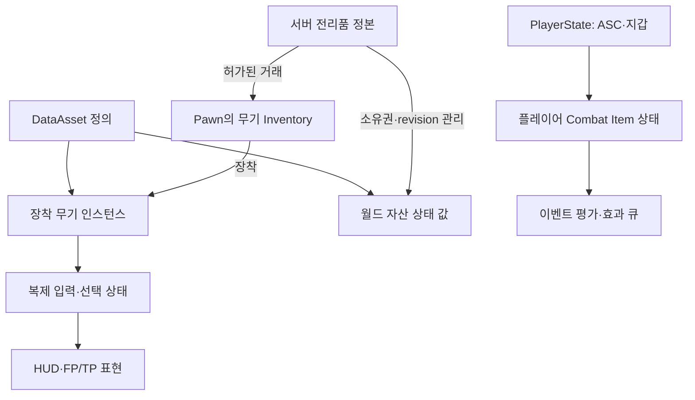

# 책임과 수명주기로 나눈 아키텍처

[← 포트폴리오](../README.md) · [현재 상태](08-current-state.md)

이 프로젝트는 **런의 공용 규칙, 개인 상태, 이동하는 자산, 반복되는 적 계산**을 분리합니다. 객체의 위치보다 중요한 것은 누가 정본을 갖고 언제 변경할 수 있는가입니다. 아래는 현재 소스에서 확인한 구조이며 최신 미커밋 성장 변경의 실행 완료를 뜻하지 않습니다.

## 주요 책임

| 경계 | 대표 구성 | 책임 |
|---|---|---|
| 서버 런 규칙 | GameMode, Director | 진입·스폰·런 진행 조정 |
| 공유 런 상태 | GameState | 참가자 봉인, 런 식별과 종료, 공유 시계·진행 |
| 개인 상태 | PlayerState | ASC, 개인 지갑, 참가 자격과 개인 빌드 |
| 장착 상태 | WeaponInventoryComponent | 슬롯·현재 무기, 무기 상태 변경 요청과 복제 조정 |
| 무기 인스턴스 | WeaponInstance | 정의 참조, 탄약·WSU·Perk와 해당 무기 상태 |
| 월드 자산 정본 | LootWorldSubsystem | 자산 소유 위치, revision, 변경 허가와 거래 예산 |
| 빌드 이벤트 | CombatItemRuntime, CombatEventSubsystem | 이벤트 규칙, 지연 효과와 작업 제한 |
| 적 운영 | EnemySpawnSubsystem | 풀 취득·반납, 스폰 지점과 생성 예산 |
| 공유 탐색 | FlowFieldSubsystem, FlowFieldComputer | 월드·베이크 연결과 표면 그래프 계산 |
| 콘텐츠 정의 | 무기·아이템·런 DataAsset | 공유 기본값과 저작 계약 |

예전 카드 관련 타입명은 일부 내부 데이터·효과 기반에 남아 있습니다. 타입 이름이 남았다는 이유로 화면형 카드 상점이나 상시 전 무기 피해 증가가 현행 게임 규칙이 되지는 않습니다.

## 정의, 상태 값, 표현을 구분한다

무기는 장착 중 UObject로 존재하고 바닥에서는 Pickup 액터로 표현됩니다. 이 둘을 동일한 UObject의 이동으로 간주하지 않습니다. 자산의 정체성과 보존할 상태 값을 유지하면서 현재 위치에 맞는 표현을 준비합니다. 재화와 소유권은 서버 정본이 결정하고 UI는 결과를 보여 줍니다.

## 높은 빈도의 계산과 드문 변경

스웜 추적은 공유 거리장을 샘플링하는 반복 경로입니다. 무기 교환·WSU 투자·아이템 소유 변경은 빈도가 낮지만 실패했을 때 손실이 큽니다. 전자는 개체당 비용을 줄이고 후자는 준비·검증·커밋을 명확히 합니다.

일반 적은 경량 HealthComponent와 비-GE 데미지를 사용합니다. 플레이어·엘리트·보스는 GAS를 활용합니다. 같은 적을 모든 참가자에게 복제하는 계약 때문에 서버 계산만 줄여서는 전체 부하가 해결되지 않습니다.

## 기반 기술과 검증 경계

Runtime과 Editor 모듈을 분리하고 엔진의 UObject·Subsystem·NetCore·GAS·Enhanced Input·CommonUI를 사용합니다. 프로젝트 코드가 추가하는 것은 공유 탐색, 자산 거래, 무기 성장, 전투 이벤트 예산과 콘텐츠 검증입니다. Push Model dirty 표시는 구현 수단이며 실제 패키지 활성화와 비용은 설정·빌드·실측으로 확인해야 합니다.

런 종료 중 콜백, 선택 상태와 인스턴스의 복제 도착 순서, 풀 재사용 이후 지연 효과가 경계의 위험입니다. [거래 사례](03-authoritative-shop.md)와 [전투 이벤트 사례](07-combat-events.md)는 이 문제를 다룹니다.
