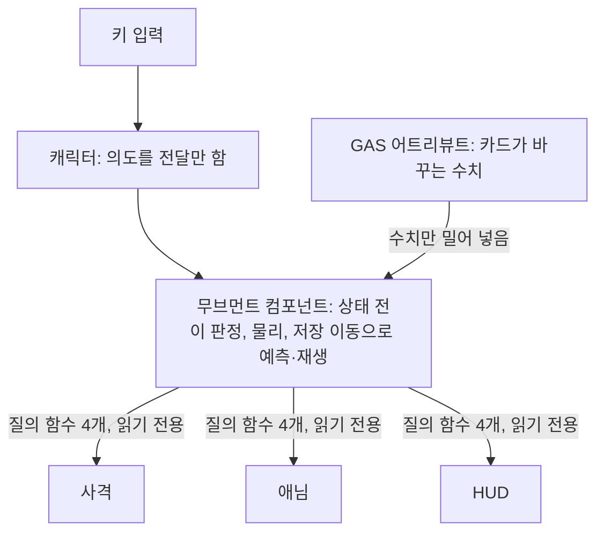

# 01. 이동 상태의 단일 소유

[← 포트폴리오](../README.md) · 다음: [02 판정과 연출의 책임 분리](02-fire-authority-presentation.md)

**기준일: 2026-11-18. 이전 단계(협동 스타일 랭크 FPS)에서 만들어 현재 단계로 이어진 설계입니다.** 현재 단계의 공유 신체도 이 이동 컴포넌트를 상속해 사용합니다([04](04-shared-body-ownership.md)).

## 문제

이동 상태(서기·달리기·앉기·슬라이딩·공중)가 늘어날 때마다 사격·애님·HUD 코드가 함께 바뀌는 구조는 상태 수만큼 수정 지점이 늘어납니다. 더 큰 문제는 네트워크입니다. 이동은 소유 클라이언트가 즉시 예측하고 서버가 같은 물리로 확인해야 하는데, 상태의 주인이 둘로 갈라지면 서버 보정 한 번에 두 상태가 어긋납니다.

## 제약

- 1~4인 협동, 리슨 서버(호스트가 자기 화면 렌더와 서버 시뮬을 함께 부담), 서버 권위
- 참조 영상에서 잰 핑 46ms에서도 이동이 즉시 반응해야 함
- 엔진의 CharacterMovementComponent(CMC)가 제공하는 저장 이동·재생 구조 위에서 동작해야 함
- 새 이동 상태를 카드나 스킬로 늘리지 않는다는 범위 결정. 카드가 하는 확장은 점프 횟수·슬라이드 거리 같은 수치와 조건까지

## 선택한 구조

무브먼트 컴포넌트 하나가 이동 상태를 결정하고, 나머지는 읽기만 합니다. 아래 불변 조건을 구조로 강제했습니다.

| # | 불변 조건 |
|---|---|
| 1 | 이동 상태의 주인은 무브먼트 컴포넌트 하나. 캐릭터·GAS·애님은 읽기만 |
| 2 | 모든 이동 상태는 클라이언트가 예측하고 서버가 같은 물리로 확인. 서버 응답을 기다렸다 움직이는 이동은 없음 |
| 3 | 이동 수치는 GAS 어트리뷰트로 복제되어 양쪽이 같은 값을 봄(무기가 정하는 수치 2개는 예외로 기록) |
| 4 | 사격·ADS는 이동 상태를 모름. 이동 상태가 "지금 사격이 되는가"를 알려줌 |
| 6 | 애니메이션은 이동 상태를 소유하지 않음. "몽타주가 끝나야 상태가 끝난다"를 만들지 않음 |
| 7 | 모든 이동 상태는 시간 상한 또는 조건 없는 탈출 경로를 가짐 |
| 8 | 프리즈·다운은 시작만이 아니라 진행 중인 이동도 멈춤 |

외부로 내주는 질의는 사격 허용 여부, 확산 입력(상태 가중치), 슬라이딩 여부, 벽 접촉 여부 네 가지입니다. 사격·애님·HUD는 상태의 복사본을 갖지 않습니다. 복사본이 생기면 원본과 어긋나기 때문입니다.

### 수치의 기록자도 하나로

같은 원칙이 상태를 만드는 수치에도 적용됩니다. 걷기 속도 상한을 쓰는 곳이 이미 네 군데(생성자, 이동 속도 배수, 다운 상태의 두 분기)였고 각자 자기 층만 알고 값을 통째로 덮어써서 서로를 지우고 있었습니다. 장비 속도라는 다섯 번째 기록자를 더했다면 "3번 슬롯을 든 채 속도 카드를 먹으면 장비 보너스가 사라지는" 결함이 설계 단계에서 확정되었을 것입니다. 그래서 상한을 쓰는 함수를 하나로 두고 나머지는 층 값을 밀어 넣기만 하게 했습니다. 이 합성만으로 기존 결함 하나(다운된 동안 속도 카드가 적용되면 쓰러진 플레이어가 움직이던 것)도 구조적으로 불가능해졌습니다. 카메라 화각도 같은 이유로 쓰는 곳을 하나로 모으자, 무기가 없으면 화각이 갱신되지 않던 기존 결함이 함께 사라졌습니다.

### 자세 전환은 상태가 아니라 가중치

앉기와 서기가 한 프레임에 끝나 시야가 약 70cm 순간이동했습니다. "전환 중"이라는 상태를 새로 만들면 상태 수와 탈출 경로 의무가 늘어납니다. 그래서 0~1 가중치 하나를 컴포넌트가 소유하고 카메라·속도 상한이 읽기만 하게 했습니다. 갱신 위치는 원격 프록시에서도 호출되는 상태 갱신 함수 한 곳이라 4인 전원의 가중치가 맞습니다.

## 검토한 대안과 기각 이유

| 안 | 내용 | 결과 |
|---|---|---|
| 채택 | 무브먼트 컴포넌트가 상태를 결정, GAS는 쿨다운·무적·수치만 담당 | 예측이 엔진의 저장·재생 구조 위에서 그대로 작동 |
| GAS 어빌리티가 상태 전이를 결정 | 쿨다운·비용·태그 차단이 공짜로 따라옴 | **기각.** 서버 보정이 올 때마다 상태의 주인이 둘로 갈라짐 |
| 기존 대시 방식(서버 RPC 후 이동)을 슬라이드로 확장 | 구현이 가장 쌈 | **기각.** 핑 46ms에서 캐릭터가 뒤로 튕김 |

**GAS 안을 기각한 이유.** 클라이언트가 t=100ms에 슬라이드를 시작하고 서버 보정이 t=80ms로 되감으라고 온 경우를 따라가 보면 차이가 보입니다. 무브먼트 컴포넌트가 상태를 소유하면 저장된 입력을 순서대로 재생하면서 슬라이드도 함께 재생되어 양쪽이 같은 상태로 수렴합니다. 어빌리티가 상태를 정하면 무브먼트는 되감기는데 어빌리티는 되감기지 않아, 어빌리티는 "슬라이드 중"인데 무브먼트는 "달리기 중"인 상태가 됩니다. 패킷 하나만 늦어도 매번 일어나는 일입니다. 엔진 소스에서 저장 이동이 재생하는 항목이 가속·점프 입력·앉기 입력·커스텀 플래그뿐이고 어빌리티 활성화는 없다는 것을 확인했습니다. GAS가 별도의 되감기 장치를 갖는다는 점은 일반적 패턴으로 알고 있으나 이 엔진 소스에서 직접 대조하지는 않았습니다. 이 안이 노렸던 이점(쿨다운·무적·수치)은 채택안에서도 GAS가 계속 담당하므로, 갈라지는 것은 "상태 전이를 누가 결정하는가" 하나뿐입니다.

**대시 방식을 기각한 이유.** 서버 RPC가 닿는 데 23ms, 그동안 클라이언트 화면은 계속 "달리기"로 시뮬레이션하고, 서버 위치 보정이 돌아오는 데 다시 23ms가 걸려 두 위치가 달라지며 뒤로 튕깁니다. 대시에서 이 문제가 눈에 띄지 않았던 것은 속도를 한 번 꽂고 끝나는 충격이라 엔진 기본 예측이 대충 따라갔기 때문입니다. 슬라이드는 속도 곡선·마찰·캡슐 높이·지속 시간이 매 프레임 이어지는 지속 상태라 같은 방식이 성립하지 않습니다. 기존 대시는 이 불변 조건을 위반하므로 폐기하고, 기본 이동에는 대시를 다시 만들지 않기로 했습니다.

### 구현 방식의 선택: 걷기 모드 확장

슬라이드를 걷기 모드 위에 둘지 커스텀 이동 모드로 만들지는 되돌리기 비용이 낮아 구현 시점으로 미뤘고, 외부 인터페이스가 이 선택과 무관하다는 것이 근거였습니다. 구현에서는 슬라이드를 걷기 모드에 두고 속도·마찰 훅만 덮었습니다. 커스텀 모드의 물리 함수는 빈 함수라 바닥 추종·계단·경사·벽 미끄러짐을 전부 다시 써야 하기 때문입니다. 대가는 엔진이 "앉아서 걷는 캐릭터"에 붙여 둔 안전장치를 하나씩 되돌리는 일이었습니다.

- 앉기 가능 조건이 공중도 허용해 공중 슬라이드가 됨 → 지면 전용으로 좁힘
- 걷기 제동이 마찰을 두 번 곱해 900 → 250cm/s가 약 0.08초에 끝나 슬라이드가 순간 정지로 보임 → 슬라이드 중 마찰을 0으로 대체
- 점프 가능 조건에 앉기 차단이 두 곳 → 둘 다 풀어야 함
- 낙하 경계에서 앉은 캐릭터의 이탈을 막는 기본값 → [06](06-debugging-and-measurement.md)의 디버깅 사례

그 뒤 엔진이 앉기 상태로 막아 두는 동작이 나오면 슬라이드에서 먼저 의심한다는 규칙을 기록했습니다.

## 범위 변경의 이력

이 설계는 같은 날의 결정으로 끝나지 않았고, 이동 상태 목록은 세 번 바뀌었습니다.

- 벽 매달리기를 지속 상태로 구현했다가, 게임 감각 결정으로 전면 폐기하고 벽 접촉 시 자동 튕김(순간 임펄스)으로 바꿈. 결과적으로 최초 판정이었던 "입력을 받지 않는 자동 동작"에 가까워졌지만 도달 경로가 달랐음. 판정이 관찰이 아니라 감각 선호로 갈렸다는 사실 자체를 근거로 남기려고 판정 이력을 지우지 않고 쌓아 두었습니다.
- 이후 자동 벽점프도 폐기하고 슬라이드와 더블점프를 기본 이동 특성으로 정함. 공중 조작은 회전과 퀘이크식 스트레이프 가산으로 구성.
- 파츠 효과가 주는 전투 이동은 두 가지 예외로 기록. 서버가 도착 자리를 정하는 순간이동(예측이 원리적으로 성립하지 않는 경우)과 공중 고정 모드 하나. 입력으로 방향·거리를 정하는 이동(점멸, 폭발 점프)은 예외가 아니라 소유자 예측 + 서버 재계산으로 불변 조건 2를 지킵니다.

벽 매달리기를 걷어 낼 때 발견한 엔진 제약 5건은 지우지 않고 남겼습니다. 이후 커스텀 이동 모드를 다시 만들 때 그대로 재사용되는 지식이기 때문입니다. 한 가지 주목할 점은 이 기록에 있던 근거 하나(엔진이 이동 결합 시 이동 모드를 비교하지 않는다)가 구현 검토에서 틀렸다고 지적되었다는 것입니다. 엔진 소스를 확인하니 시작·종료 이동 모드를 둘 다 비교하고 있었고, 결론(결합 금지 가드의 존재)은 두되 근거만 정정했습니다. 보존 목적이 "믿을 수 있는 엔진 지식"이므로 오류를 그대로 두면 목적을 배반하기 때문입니다.

## 검증

- 구조의 근거는 엔진 소스 확인입니다. 저장 이동이 재생하는 항목, 커스텀 플래그가 4개 상한이라는 점, 걷기 모드·낙하 경계 분기를 소스에서 대조했습니다.
- 통신 비용: 슬라이드의 진입 의도는 엔진이 이미 모든 이동 패킷에 싣는 앉기 입력으로 충족되어 커스텀 플래그가 필요 없었습니다. 파생 상태는 로컬 재생용으로만 저장되고 전송되지 않으므로 스톡 CMC 대비 네트워크 비용 증가는 0입니다. 이후 다른 기능이 플래그를 점유한 것은 기록에서 정정했습니다.
- 이동 수치의 산술이 순수한 부분(벽 튕김 횟수 유계 등)은 월드 없이 자동화 시험으로 검증했습니다. 충돌·스윕이 필요한 발사 자체는 자동 시험 범위 밖이라 PIE 확인이 맡았습니다.
- 낙하 경계 슬라이드 결함의 수정은 풀 리빌드와 자동화 58/58, 사용자 PIE 네 가지 동작 확인을 거쳤습니다([06](06-debugging-and-measurement.md)).

## 한계와 남은 일

- 장비 이동 속도는 예측하지 않습니다. 슬롯 전환이 서버 권위라, 클라이언트가 입력 시점에 선적용하면 서버가 거절했을 때 영구히 빠른 속도에 고착됩니다. 1 RTT 지연을 받아들였고, 걷기 상한은 가속이 접근하는 값이라 46ms에서는 체감되지 않는다는 판단입니다. 슬라이드 진입 속도가 장착 시점에 의존하지 않도록 순간 속도에서 파생되게 한 것이 이 판단의 전제입니다.
- 서버 응답이 필요한 파츠 이동은 불변 조건의 예외로 남아 있어, 다음 새 상태는 이 설계의 개정과 확인을 다시 거쳐야 합니다.
- 4인 원격 환경의 이동 예측은 검증 기록이 없습니다. 위 수치는 당시 변경에 대한 검증이며 현재 전체 조건의 인증이 아닙니다.
