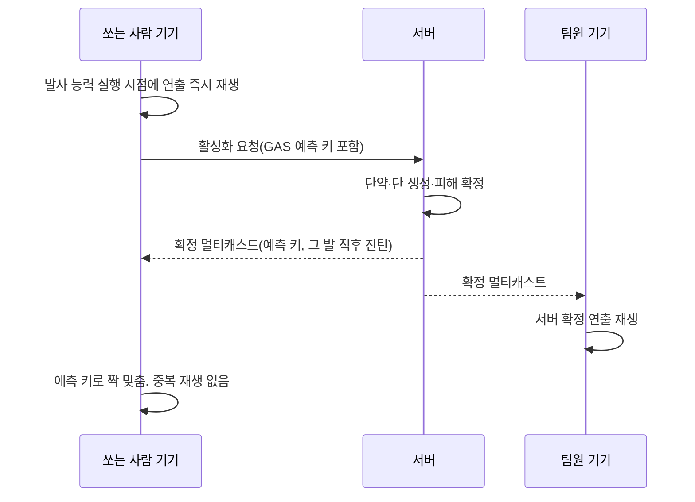

# 02. 판정과 연출의 책임 분리

[← 포트폴리오](../README.md) · 이전: [01 이동 상태의 단일 소유](01-movement-state-ownership.md) · 다음: [03 데이터 주도 파츠 빌드](03-data-driven-parts.md)

**기준일: 2026-11-18. 이전 단계(협동 스타일 랭크 FPS)에서 만들어 현재 단계로 이어진 설계입니다.** 현재 단계에서도 사격 판정은 서버가, 발사 연출은 쏘는 사람의 기기가 맡는 구조를 그대로 씁니다.

## 문제

서버가 판정을 확정해야 합니다. 그러나 클릭한 뒤 서버를 한 번 왕복하고서야 격발음·총구 화염·탄피·손 안 킥이 나오면 지연이 있는 게스트의 사격은 둔하게 느껴집니다. 호스트와 솔로는 지연이 0이라 튜닝이 호스트 기준으로 쌓여 있었습니다. 또 하나의 어긋남이 있었습니다. 플레이어 표현을 PWAS(절차적 무기 애니메이션 상용 솔루션)로 교체하면서 "서버가 거부한 발사에는 킥을 그리지 않는다"는 계약을 정했는데, 조준 반동은 처음부터 소유자 로컬 예측이라 거부된 발에도 화면이 튀고 있었습니다. 계약은 절반만 지켜지고 있었습니다.

## 제약

- 서버 권위: 탄약·탄 생성·피해·퍼짐은 서버가 정하고 이 설계에서 한 줄도 바꾸지 않음
- 플레이어는 최대 4명이라 이 경로의 비용은 적 수와 무관해야 함
- 복제 프로퍼티와 RPC를 새로 늘리지 않고 BP를 건드리지 않음
- 1인 개발이라 PWAS 폰이 검증되는 동안 옛 폰이 회귀 대조군·롤백 대상으로 남아야 함

## 선택한 구조

### 1. 권위 코어와 표현의 분리

플레이어 클래스의 서버 권위 상태(바이탈·다운·GAS 글루·인벤토리·발사 입력·상호작용)를 새 네이티브 베이스 클래스로 올리고, 1인칭 표현은 PWAS 폰이 맡습니다. 축마다 주인을 하나로 정했습니다.

| 축 | 주인 | 하지 않는 것 |
|---|---|---|
| 이동 상태 | 무브먼트 컴포넌트([01](01-movement-state-ownership.md)) | PWAS의 이동·슬라이드 토글을 쓰지 않음 |
| 발사 판정·탄약·연사·피해 | 발사 컴포넌트 + 발사 어빌리티 + 서버 발사체 | PWAS의 발사·트레이스를 두 번째 권위 경로로 두지 않음 |
| 조준 반동·연사 확산 | CrystalRecoil(반동 상용 솔루션) | PWAS 카메라 반동은 프리셋에서 끔 |
| 1인칭 표현 전체 | PWAS | C++ 절차 모션을 PWAS 폰에 병행하지 않음 |

캐릭터 타입을 쓰는 코드는 둘로 나눴습니다. 피해·바이탈·타깃팅·인벤토리·경제처럼 게임플레이를 결정하는 소비자는 베이스 타입으로 바꾸고, 1인칭 ADS·스코프·팔 애님 같은 표현 소비자는 옛 폰 캐스트를 유지합니다. 하나라도 빠지면 PWAS 폰이 조용히 피격되지 않거나 추적되지 않기 때문입니다. 베이스 클래스의 불변 조건 중 두 가지는 이렇습니다. 모든 플레이어 폰의 캡슐 오브젝트 타입은 플레이어 전용 채널이어야 하고(일반 Pawn이 되면 적이 통과하고 돔이 플레이어를 막는 가장 조용한 실패), 비로컬 폰은 1인칭 절차 연산과 팔 렌더를 하지 않습니다.

### 2. 발사 연출: 쏘는 사람은 예측으로 즉시, 팀원은 서버 확정으로

- 소유자는 발사 능력이 자기 기기에서 도는 순간 연출을 재생하고, 서버가 나중에 거부해도 되돌리지 않습니다.
- 팀원은 서버 확정 멀티캐스트로만 재생합니다.
- 소유자의 중복 억제는 확정 멀티캐스트에 GAS 활성화 예측 키(클라이언트·서버 능력이 같은 값)를 실어 발 단위로 짝을 맞춥니다. 짝보다 먼저 기록된 미확인 발은 거부로 확정합니다(한 클라이언트의 활성화는 신뢰성 전송 순서대로 처리되므로).
- 탄약에 따른 연출(잔탄 경고·빈 탄창 클릭·자동 재장전)은 소유자의 예측 잔탄으로 판단합니다. 기준은 서버가 확인에 실어 보낸 "그 발 직후 잔탄"에서 아직 확인되지 않은 내 발을 뺀 값이며, 서버는 이 값을 읽지 않습니다.
- 클라이언트 연사 루프는 서버가 반드시 거부할 발(같은 틱의 두 번째 발)을 만들지 않도록 틱당 1발로 제한합니다.

불변 조건: 소유자 기기의 발사 연출은 한 활성화당 정확히 1회(예외는 왕복이 장부 만료 1초를 넘을 때의 중복), 팀원 기기의 연출은 서버가 수락한 활성화에만. 비용은 플레이어 4명 이하의 로컬 장부(32발 이하)와 확정 멀티캐스트의 발당 2바이트입니다.

## 검토한 대안과 기각 이유

| 안 | 기각 이유 |
|---|---|
| 기존 계약 유지(확정 발사에만 연출) | 즉시 재생은 정의상 서버 응답 전에 그리는 일이라 지연 문제를 풀지 못함 |
| 거부 시 연출 되돌리기(서버→소유자 거부 알림) | 소리·화염은 되돌릴 수 없고, 장부는 다음 확인에서 이미 정확히 복구됨 |
| GameplayCue 예측 | 연출 BP 3종을 옮기는 비용 대비 이득이 없음 |
| 예측 키 없이 무기별 FIFO로 짝 맞춤 | 독립 설계 검토에서 기각. 연사 중 거부된 발의 잉여가 사라지지 않아 N발을 남기고 재장전하게 됨 |
| 명중까지 클라이언트가 예측 | 아래 계산 참고. 거짓 히트마커 |
| 사수 판정(쏜 사람 기기가 명중을 판정) | 서버 권위의 예외를 만들고, 적 1000을 목표로 하던 시점에는 위치 이력 비용도 큼 |

**명중 예측을 하지 않은 이유(측정 기반).** 옆으로 걷는 적(초속 7.5m)에 대해 게스트 화면의 적 위치와 서버가 판정하는 위치의 오차를 지연 100ms에서 쟀을 때 1.4~2.3m였습니다(2.3m는 적 962마리로 복제가 포화된 조건, 1.4m는 포화되지 않은 조건). 캡슐 폭 0.8m보다 크므로 클라이언트 예측 명중은 거짓 히트마커가 됩니다. 그래서 명중 확인(히트마커·명중음·숫자)은 지연과 비행 시간 뒤에 오는 현재 방식을 유지했습니다. 이 선택은 "연출은 순수 코스메틱이고 명중은 서버가 정한다"는 책임 분리를 그대로 지키며, 후속 조건으로 "게스트 화면 적 위치의 신선도 측정"을 남겼습니다.

## 검증

- 권위 베이스 단계(2026-09-19): 에디터 빌드와 전체 자동화 71/71 통과. 기존 플레이어·PWAS·HUD 에셋은 읽기 전용 로드로 확인했습니다.
- 발사 연출 단계(2026-09-30): 일반·유니티 비활성·강제 유니티 세 구성의 빌드 성공, 신규 자동화 4종(예측 장부, 중복 억제, 예측 잔탄 경고 층, 연사 박자)과 회귀 묶음 35건 통과. 실패 1건은 이 변경과 무관한 다른 작업의 시험이었습니다.
- 구현 전 독립 설계 검토는 조건부 통과(중대 지적 없음, 개선 5건을 명세에 반영). 병합 전 구현 검토에서 중대 결함 1건을 찾았습니다. 연사 잔여 시간을 매 틱 잘라내면 누적이 간격에 닿지 못해 풀오토가 점사 방아쇠당 1발로 죽는데, 장부 순수 테스트로는 잡히지 않는 결함이었습니다. 박자 로직을 순수 함수로 빼고 60/30fps 시뮬레이션 시험으로 고정했습니다.
- 사용자 PIE에서 정상. 지연 환경 체크리스트(왕복 50/100/150ms, 지터와 2% 손실에서 한 발 연출만 남는 것은 허용, 탄창 중간 2발 이상 남기고 재장전은 불허, 솔로·호스트 연사 속도 불변)를 마련했습니다. 기록에는 "정상"이라는 결과만 있고 항목별 수치는 없습니다.

## 한계와 남은 일

- 서버가 거부한 발에도 연출이 남습니다. 이 선택을 받아들이는 근거는 거부가 드물다는 가정이며, 실측으로 자주 일어나 "없는 탄" 연출이 거슬리면 거부 원천(연사 관용·지터)부터 줄이고, 그래도 남으면 보정 RPC를 재검토하기로 했습니다.
- 팀원 기기의 총성이 손실 뒤 몰려 재생될 수 있습니다. 거슬리면 팀원용 비신뢰성 전송과 소유자용 소유자 RPC로 나누는 것이 다음 수단입니다.
- 왕복이 장부 만료(1초)를 넘으면 소유자 연출이 중복될 수 있습니다.
- 명중 확인 지연은 줄이지 않았습니다.
- 4인 원격 환경과 지연·손실이 큰 환경의 체감은 검증 기록이 없습니다.
