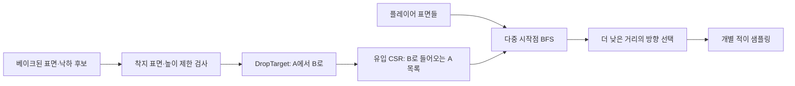

# 사례 01 · 적떼가 공유하는 길찾기와 풀

[← 포트폴리오](../README.md) · [현재 상태](08-current-state.md)

다수의 적이 공유하는 Flow Field(목표까지의 거리·진행 방향을 담은 장)와 클래스별 액터 풀을 구현한 사례입니다. 반복 탐색을 공유하고 높이·낙하·재사용의 예외를 데이터 구조에 담았습니다. 아래 구조와 과거 측정은 각각 구현 확인과 특정 조건의 실행 기록입니다.

## 문제

다수의 적이 소수의 플레이어를 추적합니다. 적마다 독립된 탐색을 반복하면 비슷한 일을 여러 번 계산하게 됩니다. 또한 경사로와 겹친 바닥이 있는 지형에서는 평면상의 같은 셀도 서로 다른 높이의 위치일 수 있습니다.

## 선택: 표면 그래프에서 공유 거리장을 계산한다

`UFPSRFlowFieldComputer`는 셀과 높이 레이어로 표면을 구분합니다. `RunBFS`는 BFS(너비 우선 탐색)로 플레이어에 대응하는 여러 표면을 시작점에 넣고, 같은 비용의 연결을 따라 거리장을 계산합니다. 각 표면의 방향은 더 작은 거리의 이웃을 향합니다. 개별 적은 계산된 결과를 샘플링합니다.

표면 수를 V, 연결 수를 E라 하면 BFS 단계는 O(V+E)입니다. 전체 재계산을 O(1)로 부르지 않습니다. 높이 레이어와 주변 탐색 범위가 고정된 개별 샘플 조회가 일정한 범위의 배열 접근이라는 점과 구분해야 합니다.

| 선택 | 얻는 것 | 감수하는 것 |
|---|---|---|
| 다중 시작점 공유 거리장 | 소수의 목표를 향한 탐색 결과 재사용 | 개별 적마다 다른 이동 비용·목표 정책을 넣기 어려움 |
| 높이 레이어를 가진 셀 | 겹친 지형의 표면을 구분 | 현재 2개 레이어의 표현 한계와 높이 선택 규칙 필요 |
| 균일 비용 BFS | 간단한 거리 계산과 검증 | 물리적 이동 시간에 대한 최적 경로를 보장하지 않음 |
| 월드 연결과 계산 객체 분리 | 합성 데이터로 회귀 테스트 가능 | 베이크 좌표계와 런타임 좌표계 변환 계약 유지 필요 |

## 단방향 낙하는 역방향 탐색이 필요하다

낭떠러지 A에서 아래 B로 내려갈 수 있어도 B에서 A로 같은 방식으로 올라갈 수는 없습니다. 목표 B에서 거꾸로 거리장을 전파할 때는 B로 떨어질 수 있는 A를 찾아야 합니다.

`RebuildDropLinks`는 허용된 낙하 높이와 착지 표면을 검사해 `DropTarget`을 만듭니다. 이어서 유입 링크를 CSR(Compressed Sparse Row: 연결 목록을 연속 배열과 시작 인덱스로 압축한 표현) 형태인 `DropInStart`와 `DropInSource`에 저장합니다. BFS가 B를 꺼내면 B로 들어오는 낙하 출발 표면만 순회합니다. 매번 전체 낙하 링크를 훑는 일을 피합니다.

연결성 레이블과 방향장 준비 상태도 분리합니다. 플레이어 시작점을 찾지 못해 방향장이 유효하지 않아도, 지형 연결성 자체는 계산할 수 있기 때문입니다. 코드의 `bConnectivityReady`와 `bFieldReady`가 이 차이를 표현합니다.

## 정확한 클래스별 풀링

`FFPSREnemyDormantPool`은 전체 휴면 적 배열 대신 **정확한 클래스 → 해당 클래스 버킷**으로 저장합니다. 일반 적과 엘리트가 상속 관계에 있어도 서로의 요청에 잘못 반환하지 않습니다.

`AcquireOfClass`는 요청 버킷에서 뒤부터 꺼내며 무효 슬롯을 제거합니다. 해시 조회는 평균 O(1)이지만, 무효 슬롯이 이어지면 해당 버킷을 순회합니다. 따라서 취득 전체가 최악의 경우까지 O(1)인 것은 아닙니다.

총 풀 용량이 한 클래스로 채워져 다른 클래스를 만들 수 없는 경우도 고려합니다. `EvictOneFromLargestOtherBucket`은 다른 클래스 중 가장 큰 휴면 버킷에서 하나를 꺼냅니다. 실제 파괴와 총량 회계는 호출하는 스폰 서브시스템의 책임입니다. 버킷 선택은 클래스 수에 비례하고, 축출이 잦으면 풀링 이점이 줄어듭니다.

## 패키지 측정으로 확인한 병목

2026-09-17에는 UE5.8 계열의 같은 Development 패키지와 맵에서 솔로와 로컬 4인 조건을 측정했습니다. Ryzen 7 7800X3D / RTX 4070 Ti, 1080p 렌더 호스트, Push Model(변경 속성을 명시하는 복제 방식) OFF 조건입니다. 4인 구성의 나머지 세 클라이언트는 **같은 PC에서 렌더 없이 60fps로 실행**했습니다. 맵은 이후 폐기된 `L_Map_1`, 패키지는 `26_9_17_BuildTest_2`입니다. 표의 P95는 프레임 시간의 95백분위 값입니다.

| 호스트 지표 | 솔로 | 로컬 4인 |
|---|---|---|
| 분석 창 / 평균 생존 적 | 76.3초 / 895 | 233.9초 / 891 |
| 평균 프레임 / P95 | 9.40ms / 12.17ms | 18.62ms / 24.93ms |
| 게임 스레드 / GPU | 9.39ms / 3.56ms | 18.57ms / 3.87ms |

평균 GPU 시간보다 게임 스레드 시간이 프레임 시간에 가까워, 이 조건의 호스트 병목은 CPU였습니다. 일괄 처리 등을 포함한 Tickables는 4.95ms→11.07ms, 서버 액터 복제는 0→1.51ms였습니다. 이 비교는 조사할 비용을 좁혀 주지만, 인원 증가에 따른 원인을 하나로 분리한 실험이나 최적화 전후 결과는 아닙니다.

1000마리 소환 요청은 모두 전달됐지만 4인 분석 창의 생존 수는 829~956으로 감소했고 맵 하단 경계(Kill-Z)에 의한 회수 44건이 있었습니다. 따라서 **1000마리 안정 유지 성능**으로 소개하지 않습니다. 두 분석 창의 이벤트 조건도 다르며 같은 PC 클라이언트의 CPU 부하가 섞입니다. 연결당 송신 약 41KB/s에도 포화가 94% 프레임에서 기록됐고 원인은 미확정입니다. 원격 4인 환경과 현재 제품맵·빌드의 성능은 별도 측정이 필요합니다.

## 검증과 한계

기존 회귀 시험은 잘못된 층 선택과 정확한 클래스 구분을 다루도록 작성되어 있습니다. 이번 문서 작업에서 시험이나 성능 측정을 새로 실행하지 않았습니다. 적 1000+는 구조가 버텨야 하는 스트레스 목표이며 실제 동시 수는 Director와 예산에 따라 달라집니다.

높이 레이어 수, 베이크 해상도, 동적 장애물 반영, 낙하 연결, 네트워크 복제는 각각 별도 검증 항목입니다. 길찾기 계산 공유만으로 렌더링·충돌·복제까지 해결됐다고 볼 수 없습니다.
