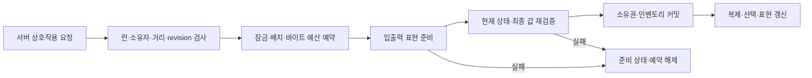
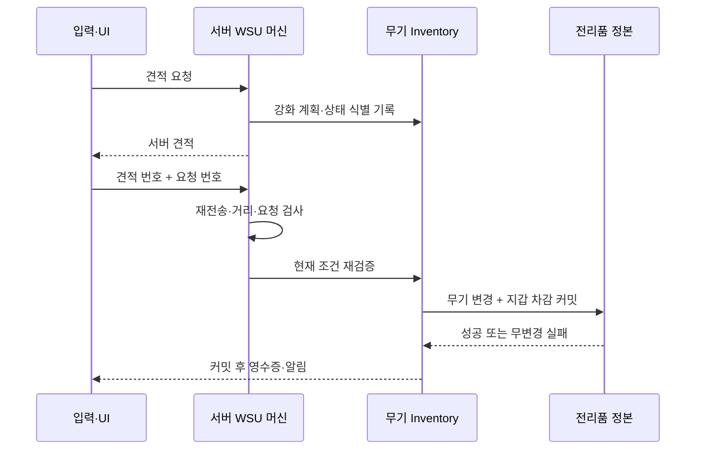

# 사례 02 · 서버 권위의 전리품과 월드 거래

[← 포트폴리오](../README.md) · [검증 범위](05-verification.md)

## 문제: 결과만큼 실패 경로도 중요하다

협동 전투는 줍기와 구매 중에도 계속됩니다. 두 플레이어가 같은 무기를 집거나 견적을 본 뒤 지갑·런·캐릭터가 바뀔 수 있습니다. 이전 무기를 바닥에 놓지 못했는데 새 무기만 장착하거나 재전송 때문에 돈이 두 번 빠지면 안 됩니다.

자산의 정체성과 소유 위치를 한 곳에서 관리하고, 실패할 수 있는 준비를 끝낸 뒤 상태를 함께 바꾸는 것이 핵심입니다. 전리품 기반은 기존 구현입니다. 후반의 WSU(Weapon Stat Upgrade: 무기 스탯 강화) 구매와 공용 처치 Coin 변경은 최신 미커밋 코드·정적 검토 단계로 구분합니다.

## 자산 정체성과 변경 권한

전리품 정본(ledger: 자산과 소유 위치를 중앙에서 기록하는 원장)은 자산 ID, 런 ID, revision(상태 변경 버전)과 소유 위치를 함께 관리합니다. Inventory와 Pickup은 그 자산의 장착·월드 표현입니다. 서버가 발급한 제한된 변경 허가 안에서만 상태를 쓰고 오래된 revision의 요청을 거부합니다.

**동작 예시:** A와 B가 같은 바닥 무기의 revision 7을 보고 줍기를 요청했다고 가정합니다. A의 거래가 먼저 커밋되면 자산의 위치와 버전이 바뀝니다. 뒤늦게 도착한 B의 revision 7 요청은 현재 상태와 맞지 않아 거부되어야 합니다. 서버 게임 스레드에서 요청을 순서대로 처리해도, 각 클라이언트가 보고 요청한 상태의 시점은 다를 수 있습니다. 이 예시는 오래된 요청을 구분하는 이유를 설명하며 별도로 실행한 시험 결과는 아닙니다.

게임 스레드의 동기 거래 경계입니다. 임의의 외부 부작용을 되돌리는 범용 롤백으로 설명하지 않습니다. 실패할 수 있는 준비를 먼저 끝내고 커밋과 이후 알림을 구분합니다.

플레이어가 버린 Combat Item(플레이어 빌드를 구성하는 아이템) 묶음은 일반 바닥 드롭의 만료·FIFO 정리에서 보호합니다. 보호 공간이 부족하면 버리기를 거부하고 수량·효과를 유지합니다. 부분 줍기는 수용 가능한 양만 옮기고 나머지 묶음을 남깁니다. 예산은 최종 액터 수뿐 아니라 준비 중 표현·바이트와 이탈 복구 여유도 고려합니다.

## WSU 자판기: 본 조건과 실제 커밋 연결

최신 코드의 WSU 머신은 서버 견적과 구매를 나눕니다. 견적에는 현재 무기와 가능한 강화 결과가 담깁니다. 구매에는 견적 일련번호와 요청 일련번호가 필요합니다.

| 바뀔 수 있는 조건 | 구매 시 확인하는 경계 |
|---|---|
| 플레이어·Pawn·런 | 소유 관계, 런 식별·세대, 참가 자격 |
| 무기·슬롯 | 자산 revision, Inventory와 선택 revision |
| 잔액 | 지갑 revision, 정확한 차감 준비 |
| 머신 교체·파괴 | 머신 수명과 결과 일련번호 |
| 중복 입력·콜백 재진입 | 요청 일련번호, 재전송 영수증, 거래 가드 |

같은 유효 요청의 재전송은 저장된 영수증을 반환합니다. 알림 도중 런·소유 관계가 바뀌면 뒤따르는 오래된 무기·UI 알림을 억제하도록 문맥을 다시 검사합니다. 승인 규칙은 10 Coin으로 최대 3회 강화, 일부만 가능해도 정가, 후보가 없으면 결제 전 차단입니다. 실제 머신 콘텐츠·네트워크 실행은 아직 완료 근거가 없습니다.

## 공용 보상과 개인 소유

최신 승인 규칙에서 처치 Coin은 공용 실물 하나입니다. 획득하면 남은 런 참가자 각각에게 같은 양을 지급합니다. Downed 참가자도 수신 대상이고 수거자는 활동 가능해야 합니다. 팀 진행은 지갑 수만큼 곱하지 않고 실제 지급 가치를 한 번 집계합니다. 최신 코드는 전원 지갑 변경을 먼저 준비하고 커밋 후 알림하도록 작성되었습니다.

처치 Coin을 바닥 상한·배치·액터 생성 실패로 만들지 못하면 즉시 동액 팀 지급하는 규칙도 승인되었습니다. 이미 생성된 Coin의 만료나 비처치 보상을 같은 정책으로 확대하지 않습니다. **최신 경로는 빌드·자동화·다인 검증 대기입니다.** WSU는 본인만 보고 명시적으로 현재 무기에 사용하며 실패 시 소모하지 않는 개인 드롭입니다.

Stock의 4후보 균등 무작위 구매·공용 바닥 배출은 승인 설계입니다. 새 구현은 가격·HP·리롤 병합 등의 순수 계산 지원이며 실제 Stock 거래 호출부는 없습니다. Recycler는 투입자 귀속·실제 수량 환급이 설계되어 있지만 환급 계산·Carry/Throw 연결이 남았습니다.
