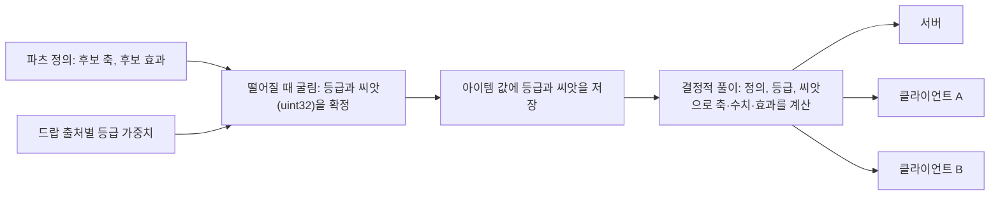

# 03. 데이터 주도 파츠 빌드

[← 포트폴리오](../README.md) · 이전: [02 판정과 연출의 책임 분리](02-fire-authority-presentation.md) · 다음: [04 공유 신체의 소유권](04-shared-body-ownership.md)

**기준일: 2026-11-18. 이전 단계(협동 스타일 랭크 FPS)에서 만든 설계입니다. 현재 단계에서는 쓰지 않습니다.** 현재 단계로의 전환 때 파츠 능력은 꺼 두기로 했습니다(첫 묶음은 기본 사격과 조준만 켬). 이 문서는 "수치를 반복 조정해야 하는 성장 시스템을 데이터로 표현하고 모든 기기에서 같은 값으로 재현하는 방법"의 사례로 남깁니다.

## 문제

이 단계의 게임은 플레이어 1명이 총 1정을 끝까지 키우는 구조였습니다. 총을 주워 바꾸는 방식을 폐기한 이유는 대부분의 플레이어가 한 총만 쓰기 때문이고, 그렇다면 3정을 들고 다니는 기능은 의미가 없고 성장이 총을 바꿀 때마다 매몰 비용이 되기 때문이었습니다. 총 한 정의 성장을 파츠(몸체, 총구, 조준경, 탄창, 개머리판, 하부, 탄환, 칩)로 표현해야 했고, 다음이 동시에 필요했습니다.

- 같은 이름의 파츠를 다시 주웠을 때 가치가 달라야 줍기·교환 판단이 생김
- 수치는 기획이 반복해서 조정하므로 코드가 아니라 데이터에 있어야 함
- 4명이 같은 파츠를 보고 같은 값을 계산해야 함(복제와 일치)

## 제약

- 파츠 효과는 총 안에서만 작동함(캐릭터 상시 스탯을 바꾸는 파츠는 만들지 않음)
- 상한·용량·무게 같은 비용 장치를 두지 않고, 개별 단점과 소수의 상쇄 쌍으로 균형을 잡음
- 서버 권위이므로 굴림 결과를 클라이언트가 따로 정하면 안 됨
- 1인 개발이라 파츠 정의 수가 곧 제작량이므로 정의는 최소로, 변주는 굴림이 만들어야 함

## 선택한 구조

**정의와 개체를 나눕니다.** 파츠 정의는 칸, 이름, 외형, 후보 축 목록, 후보 효과 목록만 가집니다. 수치와 등급은 정의에 없고, 파츠가 떨어질 때마다 개체에 굴립니다.

- **등급**: 일반·파랑·보라·빨강(빨강은 몸체 전용). 등급은 출처별 가중치로 굴립니다.
- **축 굴림**: 등급 규칙에 따라 정의의 후보 축 안에서만 굴립니다. 축 개수는 1부터 등급별 최대(일반 2, 파랑 3, 보라 3, 빨강 3)이고, 축마다 증가 75%·감소 25%, 최소 1축은 증가를 보장합니다. 수치 범위의 초기값은 일반 +2~4/−1~2, 파랑 +4~7/−2~3, 보라 +10~15/−3~6, 빨강 +15~20/−5~10입니다. 효과가 있는 파츠는 효과 수치도 개체마다 굴립니다(초기 ±20%).
- **몸체**: 몸체의 고유 특성은 그 총기 원래 성능(무기 데이터 그대로)이며, 몸체에 별도 효과가 붙는 것은 보라 등급부터입니다.
- **결정적 풀이**: 개체마다 굴림 씨앗(uint32)을 아이템 값에 싣고, 결과(축·수치·효과)는 (정의, 등급, 씨앗)에서 결정적으로 풀어 모든 기기가 같은 값을 봅니다. 등급은 이미 개체 값으로 존재했고, 구간 후보도 발급 시점에 등급과 씨앗을 확정합니다. 결과 자체를 복제하지 않고 입력 세 개만 가지므로 복제량이 작고, 기기마다 값이 어긋날 길이 없습니다.
- **상쇄 경고**: 효과가 서로 부딪히는 한 쌍(산탄총 초크 ↔ 슬러그탄)은 줍기 전에 경고하되 차단하지 않습니다. 같은 칸끼리는 동시에 장착할 수 없으므로 상쇄 쌍으로 쓸 수 없습니다.

데이터 규모는 파츠 40종, 효과 21종입니다. 정의 수가 많지 않아도 개체 굴림이 변주를 만듭니다.

## 검토한 대안과 기각 이유

| 안 | 기각 이유 |
|---|---|
| 수치만 굴림 | 축이 고정이라 같은 이름의 파츠가 성능 구성까지 같아 변주가 약함 |
| 축까지 칸 전체에서 굴림 | **이름으로 성능을 예측할 수 없음.** 플레이어가 줍기 전에 파츠의 성격을 판단할 수 없게 됨. 그래서 후보 축을 정의에 붙이고 그 안에서만 굴림 |
| 등급을 정의별로 고정 | 정의 수가 많아지고 같은 이름 반복의 가치가 낮음 |
| 몸체마다 새 고유 특성 | 구현량이 늘고, 몸체는 총기 고유 성능으로 이미 구별됨 |
| 같은 칸 안의 상쇄 쌍 | 동시에 장착할 수 없어 의미가 없음(사용자 지적) |
| 칸 강화의 무게 비용·용량제·등급 상한 | 개별 단점과 소수 상쇄 쌍으로 대체. 무게 비용은 보라 장착 편중을 계측한 뒤 재검토하기로 함 |

## 검증

- 파츠 빌드의 기본 설계는 독립 설계 검토에서 1회차 반려, 2회차 조건부 통과였고, 이후 범위 축소(캐릭터 상시 스탯 파츠 취소)로 3회차는 실시하지 않았습니다.
- 구현은 하위 작업자가 맡고 주 작업자가 검토했으며, 굴림 씨앗 단계는 구현 전 독립 설계 검토와 병합 전 구현 검토 범위에 포함했습니다. 구현 검토는 조건부 통과(중대 결함 0, 주요 2건: 구간 카드에서 몸체에 맞지 않는 파츠를 고르면 발밑에 떨어지고 구간은 소비된다는 규칙의 보강, 해시 비교의 대소문자 무관 처리)였고 지적 7건을 수정했습니다.
- 데이터 검증기로 파츠 40종이 유효함을 확인했고, 관련 자동화 묶음 195/195를 통과했습니다(당시 기록). 이후 묶음 시험 수가 늘어난 기록(196)이 있어 195는 해당 시점 값입니다.

## 한계와 남은 일

- 이 문서의 굴림 규칙은 2026-10-28 시점의 설계입니다. 이후 무기별 빌드를 정리하면서 파츠 굴림을 "등급 + 슬롯 축 1개의 수치 굴림 한 줄"로 재정의했고(핵심 파츠는 확정 드랍과 저확률 드랍으로 분리), 레벨업도 무작위 강화에서 플레이어 선택으로 바뀌었습니다. 결정적 풀이의 원칙(입력 세 개로 모든 기기가 같은 값)은 유지되었습니다.
- 현재 단계의 전환으로 파츠 능력은 꺼져 있고 채택 여부는 나중에 정합니다.
- 결정적 풀이의 기기 간 일치를 다인 네트워크에서 확인한 기록은 이 문서가 근거로 삼은 자료에 없습니다. 위 검증은 데이터 유효성과 자동화 시험까지입니다.
- 줍기·교환 판단을 만드는 변주가 실제로 재미를 만드는지는 플레이 판단이 필요한 항목으로, 측정 기록이 없습니다.
