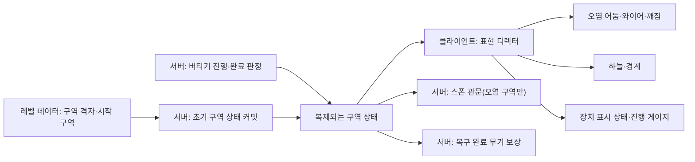

# 사례 02 · 구역 복구 체인과 서버 권위 상태

[← 포트폴리오](../README.md) · [현재 상태](08-current-state.md)

**2026-10-23 기준 기록입니다.** 런의 1차 목표인 구역 복구 체인의 구조와, 구현 중 실제로 겪은 결함 한 건을 다룹니다. 설계 승인, 코드 구현, 실행 검증, 미검증을 구분해 적었습니다.

## 문제: 무엇을 해야 하는지 알 수 없다

플레이 테스트에서 가장 크게 나온 피드백은 "들어와서 무엇을 해야 할지 모르겠다"였습니다. 20:00 보스까지 생존한다는 규칙만으로는 중간 목표가 없었습니다. 게임의 정체성인 정화·복구팀 컨셉과 맞는 직관적인 목표가 필요했습니다.

## 프로젝트의 선택

런의 1차 목표를 **오염된 구역을 복구 장치로 되찾아 보스전 전장을 넓히는 것**으로 정했습니다(DL-132). 시간 진행과 20:00 보스는 유지하고, 복구 결과가 보스전을 치를 공간의 질로 돌아오게 했습니다.

| 항목 | 규칙 |
|---|---|
| 맵 | 약 60m 타일 하나가 구역 하나이며, 상하좌우 맞닿음이 구역 그래프입니다. 그래프는 미리 구운 데이터이고 실행 중 바뀌지 않습니다 |
| 구역 상태 | 오염 또는 복구 두 가지이며, 복구는 그 판에서 되돌아가지 않습니다 |
| 복구 장치 | 구역마다 한 곳에 있고, 한 번 작동합니다. 켜면 그 구역과 맞닿은 구역이 복구됩니다 |
| 진행 | 장치가 있는 구역 안에 쓰러지지 않은 플레이어가 한 명 이상이면 진행하고, 없으면 정지합니다(감소 없음) |
| 오염 구역 | 진입은 가능하지만 빛이 거의 없고 지속 피해가 있습니다. 적은 모든 오염 구역에서 스폰합니다 |

장치 조작은 플레이 테스트를 거치며 바뀌었습니다(DL-175). 처음에는 장치 반경 12m 안에 머물러야 했으나, 사용자 PIE 피드백으로 "원 안에 묶이기보다 구역 안에서 움직이며 싸우는 편이 맞다"고 판단해 구역 체류 판정으로 바꿨습니다. 같은 날 두 번 더 좁혔습니다. 모든 장치가 자동으로 켜지면 지나가다 오염 구역 장치가 켜지고, 멈춘 채 방치된 버티기가 다른 장치를 전부 막기 때문입니다. 그래서 자동 시작은 시작 구역 장치만 쓰고, 장치는 복구된 구역에서만 켜게 했습니다. 이 규칙은 복구 영역이 항상 한 덩어리로 넓어지는 효과도 냅니다. 쓰인 장치의 이웃 구역은 모두 복구되므로, 오염 구역과 맞닿은 복구 구역에는 쓰지 않은 장치가 항상 남습니다.

## 서버 권위 상태와 클라이언트 표현의 분리

구역 상태는 서버가 판정하고 GameState가 복제합니다. 어둠·하늘·경계·장치 연출은 이 복제 값을 읽는 클라이언트 표현이며, 표현이 게임 판정을 바꾸지 않습니다.

표현 쪽은 공용 마스터 재질과 후처리 한 패스로 구역을 판정합니다. 픽셀의 월드 위치로 구역을 찾으므로 구역마다 재질이나 액터를 늘리지 않습니다. 복구 전환은 장치의 마지막 파동 전선을 따라 오염이 걷히도록 했습니다. 어둠 정도와 같은 수치는 조정값이며 코드에 고정하지 않았습니다.

## 구역 복구가 무기 공급원이 되는 연결

DL-180에서 코인·자판기·상점을 제거하고 무기 공급을 처치 드랍, 구역 복구 완료, 비행 표적 미션 보상으로 바꿨습니다. 구역 복구가 끝나 장치가 사라지는 시점에 참가 중인 비관전 플레이어 한 명당 무기 한 개를 확정 지급하고, 인당 25% 확률로 하나를 더 줍니다. 모두 공유 실물이며 바닥 무기는 수명이 있습니다. 복구 목표가 전투의 보상과 직접 이어지므로, 복구 진행이 곧 빌드 성장의 기회가 됩니다. 지급 대기열 구현과 독립 검토(G1·G2) 기록은 있으나 이 보상 경로를 실제 플레이로 확인한 기록은 찾지 못했습니다.

## 결함 사례: 맵 전체가 복구색으로 보이다 오염으로 튄다

**증상.** 멀티플레이에서 인게임에 들어오면 맵 전체가 정상 색이다가 잠시 뒤 오염 구역이 어둡게 바뀌는 장면이 보였습니다. 싱글플레이에서는 재현되지 않았습니다.

**원인.** 서버가 초기 구역 상태를 런 데이터 봉인 시점에만 커밋했습니다. 봉인은 전원의 로딩 완료 또는 30초 타임아웃에 일어납니다. 그 전까지 클라이언트의 표현 디렉터는 "동기화 전"을 "모든 구역 어둠 없음"으로 그렸습니다. 근본 원인은 하나의 동기화 플래그가 **구역 상태를 안다**와 **런이 시작됐다**라는 두 의미를 함께 가진 점이었습니다. 앞의 사실은 레벨 데이터로 월드 시작 때 이미 정해져 있는데도 뒤의 사실에 묶여 있었습니다. 싱글플레이는 봉인이 즉시 일어나 문제가 보이지 않았습니다.

**선택과 기각.** 클라이언트가 표시를 예측하는 안은 서버 상태와 어긋날 여지가 남아 기각했습니다. 커밋 시점만 앞당기는 안은 봉인 전에 자동 버티기가 시작되는 회귀를 만들어 기각했습니다. 채택한 안은 서버가 GameState를 얻는 즉시 초기 상태를 커밋하고, "런이 시작됐는가"는 이미 복제되는 별도 사실인 봉인 여부로 명시적으로 판정하는 것입니다. 버티기 시작·진행과 장치 상호작용은 봉인 전에 막고, 봉인 전 장치는 동기화 중으로 표시합니다.

**독립 검토.** 복제 값의 최초 커밋 시점과 서버 권위 판정 조건을 바꾸는 변경이라 고위험 게이트(계획 G1, 머지 G2) 대상이었습니다. G1은 두 가지를 지적했습니다. 목표("들어오는 순간부터 최종 상태")가 비목표(GameState 도착 전 구간)와 모순된다는 점, 그리고 명세가 전제한 시작 구역 카운트다운이 코드에 존재하지 않는다는 점이며, 둘 다 명세를 정정했습니다. G2는 푸시 가능 판정과 함께 경미한 지적 4건을 냈습니다. 그중 3건은 수용했고(종료 시 새 플래그 두 개 초기화 누락 포함), 월드 시작 중 GameState가 이미 있는 즉시 커밋 경로를 직접 지나는 시험은 후속으로 남겼습니다.

## 검증 범위

| 구분 | 내용 |
|---|---|
| 확인함 | 구역 복구 런타임(상태 복제, 장치 버티기, 스폰 관문, 오염 피해) 구현과 독립 검토 반영 기록 |
| 확인함 | ZONE-INIT-SYNC: 빌드 성공, 구역 관련 자동화와 모듈 로드 시험 58/58 통과, 게이트를 제거한 변형에서 새 시험이 실패함을 구현자가 확인 |
| 확인함 | ZONE-INIT-SYNC: 사용자 멀티플레이 확인에서 봉인 시점 색 변화와 접속 직후 깜빡임이 관찰되지 않음 |
| 확인함 | 장치 자동 시작·진행 게이지·낙하 설치·복구 구역 한정은 사용자 PIE 확인 기록이 있음. 마지막 규칙 변경 직후의 확인 범위는 기록상 일부임 |
| 확인함 | 하늘·어둠 표현은 사용자 PIE 피드백으로 여러 차례 조정했고 후처리 비용 절감 작업을 거침 |
| 남음 | 구역 복구 완료 무기 보상의 실제 다인 플레이 확인 |
| 남음 | 4인 협동에서 복구 체인 전체를 끝까지 진행한 장시간 검증, 버티기 시간(75초)과 장치 횟수 재조정 |
| 남음 | 접속 직후 GameState가 도착하기 전 구간의 표시는 설계상 제거 대상이 아니며, 관찰되지 않았을 뿐입니다 |
