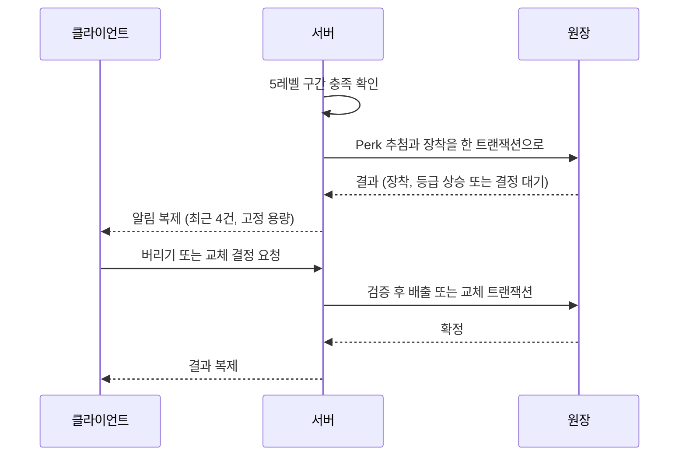

# 사례 03 · 무기 인스턴스와 성장: 화폐 없이 전투로 강해지는 구조

[← 포트폴리오](../README.md) · [현재 상태](08-current-state.md)

**2026-10-23 기준.** 이 문서는 ART: Arcade Reclamation Team(개발 코드명 FPSRoguelite)의 무기 성장·공급 설계와 그 검증 범위를 정리합니다. 설계 승인, 코드 구현, 실행 검증, 미검증을 구분해 적습니다.

## 문제: 같은 무기 정의에서 서로 다른 무기가 나와야 한다

동일한 무기 정의를 쓰더라도 무기마다 강화 수준과 부착 Perk는 다릅니다. 공통 DataAsset에 개인 상태를 저장하면 소유자의 값이 섞이고, 다시 집을 때 기본 무기로 초기화하면 성장의 의미가 사라집니다. 협동 4인에서는 무기가 바닥에서 다른 사람에게 넘어가므로 이 문제가 더 두드러집니다.

공개 데모 직전까지의 설계는 코인으로 자판기에서 무기를 사고 강화하는 구조였습니다. 플레이 관찰과 구역 복구 구조 도입 이후 이 경로가 성장 체감을 흐린다고 판단했고, 성장과 공급을 모두 전투 안으로 옮겼습니다. 아래는 그 결과입니다.

## 1. 정의와 인스턴스의 분리, 상태 보존 (유지)

| 구분 | 소유 범위 | 내용 |
|---|---|---|
| 무기 정의 | 공유 DataAsset | 모델별 기본 수치와 6축 강화 규칙. 런타임에 쓰지 않음 |
| 무기 인스턴스 | 개별 무기 | 총 강화 수치(WSU), 누적 경험치, 부착 Perk, 탄약 |
| Weapon Perk | 무기 인스턴스 | 그 무기의 행동 변경. 같은 Perk는 한 번만 보유하고 중복은 등급 상승 |
| Combat Item | 플레이어 런 빌드 | 무기를 바꿔도 유지되는 이벤트 효과와 캐릭터 스탯 |

무기를 떨어뜨리거나 다른 사람이 주워도 자산 정체성, WSU, 경험치, Perk를 그대로 옮기고, 최종 수치는 새 소유자 문맥에서 다시 계산합니다. 입력에서 최종 수치를 만들고 변경 시 캐시를 무효화하며, 수식 시험과 별개로 실제 발사·탄도·재장전 소비부에 결과가 도달하는지 따로 확인합니다.

## 2. 성장 = 그 무기로 싸운 만큼

승인된 규칙(DL-129)은 무기 레벨을 별도 숫자로 두지 않고 **총 WSU**로 정의합니다. 총 WSU는 획득 시점에 정해진 자연 WSU와 전투로 얻은 강화의 합입니다. 개인 WSU 처치 드롭과 WSU 자판기는 이미 걷어냈습니다.

- 경험치 = 적 체력과 실드가 실제로 줄어든 양을 무기군·기초 품질 기준의 표준 DPS로 나눈 값입니다. 오버킬, Combat Item 피해, 아군·파괴물 피해는 제외합니다.
- 경험치는 지금 들고 있는 무기가 아니라 **피해를 낸 무기 인스턴스**에 쌓입니다. 바닥에 있거나 넘겨진 무기도 같은 규칙입니다.
- 분모에 강화 수치가 들어가지 않으므로 강한 무기가 더 빨리 성장하는 눈덩이가 의도적으로 생기고, 레벨별 필요 경험치 곡선으로 상쇄합니다.
- 공개 데모 무기 패널은 Lv.n만 표시합니다(DL-166). 비교 점수인 Power 표시는 데모 뒤로 미뤘고, 성능 점수 수학과 계획은 있으나 제품 연결은 완료하지 않았습니다.
- 레벨업 연출은 1인칭 총에서 일어납니다(DL-182, DL-185): 총 색 펄스와 흰빛, 화면 고정 스탯 자막, 효과음 1개. 본인 화면 전용이며 복제하지 않습니다. 기본 권총은 누르고 있으면 단발을 반복합니다(DL-186).

## 3. Perk 자동 장착과 서버 결정 경계

처음에는 10레벨마다 후보 3종 중 하나를 고르는 선택 창이었습니다(DL-129). 사격 흐름을 끊고 조작 오류도 낳아 DL-178에서 폐기했습니다.

| 규칙 | 내용 |
|---|---|
| 자동 장착 | 5레벨마다 호환 Perk 하나를 서버가 무작위로 즉시 장착. 보유 Perk와 겹치면 등급 +1 |
| 제외 | 이미 최고 등급이거나 호환되지 않는 Perk는 후보에서 제외 |
| 버리기 | 알림이 뜬 동안 G 짧게 누르면 버림. 등급이 올랐다면 원래 등급으로 복귀 |
| 칸이 가득 찬 경우 | 결정 대기. G 길게 누르면 교체 화면, 무입력 시간 초과는 버리기 |
| 바닥 Perk | Perk 전용 상한 8개, 넘치면 가장 오래된 Perk만 삭제 |

클라이언트는 결정만 요청하고 추첨·장착·배출은 서버가 확정합니다. 대기 중인 Perk 복제와 결정 요청이 서버 권위 경로에 속하므로 이 변경은 고위험으로 분류해 독립 계획 검토와 머지 전 검토를 거쳤습니다. 한 구간이 밀려 여러 개 쌓여도 한 번에 한 건씩 처리하고, 교체와 등급 복귀는 같은 원장 트랜잭션 안에서 실행해 무기가 둘로 불어나지 않게 합니다.

## 4. 공급원 재설계: 왜 화폐 경로를 걷어냈는가

화폐를 거치면 "잡았다 → 돈을 얻었다 → 자판기에서 샀다 → 강해졌다"로 인과가 네 단계로 늘어납니다. 구역을 한 칸씩 복구해 나가는 구조에서는 전투 현장에서 바로 보상이 떨어지는 편이 맞다고 판단했습니다(DL-165, DL-180, ADR 0047). 데모에 남은 코인 용도가 무기 자판기 하나뿐이었다는 점도 근거였습니다.

| 공급원 | 규칙 |
|---|---|
| 처치 드랍 | 적 데이터에 둔 등급별 확률. 초기값은 엘리트 30%, 일반 0.1% |
| 구역 복구 완료 | 복구 장치 위치에 참가 중인 비관전 인원당 1개 확정, 인원당 25% 추가 |
| 비행 표적 미션 | 성공 시 인원당 1개 확정. 기존 미션은 전부 제거하고 1종만 유지 |

- 모두 서버가 만든 **공유 실물**이며 보스 드랍은 없습니다. 확정 보상은 생성이 막혀도 재시도 큐에 남기고 조용히 사라지지 않게 합니다.
- 무기 생성은 공용 생성기 하나로 하고, 출처별로 품질 분포만 달리합니다.
- 바닥 무기는 수명 90초(5초 전 경고)와 무기 전용 상한 24개를 두고, 넘치면 처치 드랍으로 나온 무기부터 퇴거합니다.
- 코인 지갑, 무기·Perk 구매기, 품질 도박, 재활용기, 기존 미션을 제거했습니다. Combat Item 처치 드랍은 유지합니다.

**기각한 대안.** 엘리트와 구역 복구에서만 무기를 주는 안은 교전 중 줍기의 부담을 줄이지만, 처치 중 발견하는 재미를 포기해야 해 채택하지 않았습니다. 플레이어별 가시성 드랍은 독식을 막지만 새 복제 구조가 필요한 고위험 변경이라 공유 실물로 충분한지 먼저 보기로 했습니다. 두 안 모두 교전 중 줍기가 사격감을 해친다는 플레이 판정이 나오거나 4인 독식이 실제 불만이 되면 다시 검토합니다.

## 5. 검증 범위

| 항목 | 상태 |
|---|---|
| 무기 경험치와 레벨 성장 | 코드 구현. 표준 DPS와 경험치 곡선은 실제 무기 데이터로 속도 모델 시험(가동률 50% 가정), 실제 플레이로 곡선 계수를 맞추는 일은 남음 |
| Perk 자동 장착·버리기·교체 | 코드 구현, 독립 계획 검토와 별도 모델 머지 전 검토 반영, 빌드 성공. 연관 묶음 시험은 기존 실패를 기준 코드와 대조해 이번 변경 원인이 아님을 확인. **실제 플레이 확인 대기** |
| 무기 공급(처치·구역 복구·미션 보상) | 1~3단계 구현·푸시, 단계별 검토 통과. 확률, 수명, 상한은 플레이 조정 대상 |
| 코인·자판기·상점 제거 | 데모 맵·콘텐츠에서 제거하고 제거 명세를 확정. 남은 내부 코드·지갑 정리는 후속 단계 |
| 레벨업 연출, 권총 반복 | 빌드와 UI 시험 통과, 사용자 실행 확인 |
| 다인 네트워크 실행, 4인 공유 실물 | 자동 시험 중심. 4인 실제 플레이 확인은 남음 |
| Power 비교 점수 | 데모 뒤로 연기. 제품 연결 미검증 |

핵심 검증 경계는 **상태 운반 → 최종 계산 → 실제 소비 → 서버 확정**입니다. 위 표에 완료로 적지 않은 항목은 완료가 아닙니다.
