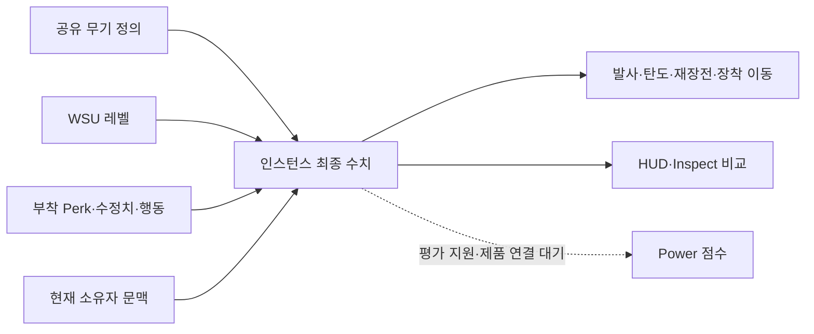

# 사례 03 · 무기 인스턴스와 성장 책임의 분리

[← 포트폴리오](../README.md) · [현재 상태](08-current-state.md)

## 문제: 투자한 무기를 다른 사람이 주워도 같은 무기여야 한다

동일한 무기 정의를 쓰더라도 탄약·투자·부착 Perk는 다릅니다. 공통 DataAsset에 개인 상태를 저장하면 소유자의 값이 섞이고, 다시 집을 때 기본 무기로 초기화하면 투자·교환의 의미가 사라집니다. 정의는 공유하고 런타임 상태는 인스턴스와 전리품 값으로 보존합니다.

## 성장 시스템의 경계

| 시스템 | 소유 범위 | 역할 |
|---|---|---|
| WSU | 무기 인스턴스 | 모델별 강화 레벨. 자연 생성과 투자에 같은 후보·효과 적용 |
| Weapon Perk | 무기 인스턴스 | 해당 무기의 플레이 방식과 조건부 행동 변경 |
| Combat Item | 플레이어 런 빌드 | 무기 교체 후에도 유지되는 이벤트 효과·허용된 캐릭터 상시 스탯 |
| Weapon Power | 인스턴스 비교 정보 | 성능 점수. 피해에 다시 곱하지 않음 |

Perk는 같은 정체성을 한 무기에 한 번만 보유하고 높은 희귀도 교체·잔여 쿨다운·분리 후 상태를 고려합니다. Combat Item 상시 효과는 체력·실드·이동 등 캐릭터 스탯에 한정합니다. 예전 전 무기 상시 피해·연사 증가 카드 설명은 현행 규칙이 아닙니다.

입력에서 최종 수치를 계산하고 변경 시 캐시를 무효화합니다. 수식뿐 아니라 실제 발사·탄도·이동 소비부에 결과가 도달하는지 별도로 확인합니다. 순수 수식 시험만으로 소비부 연결 완료를 주장하지 않습니다.

## 모델마다 다른 성장

승인 설계는 AR·MG·SR·GL·SMG·SG·Pistol 각각 6축입니다. 피해·탄창 같은 공통 축과 MG 스핀업, SR 관통 대상 수, GL 폭발 가장자리 비율 등 전용 축이 있습니다. WSU +1은 원시 스탯 +1이 아닌 축별 강화 레벨입니다.

| 예 | 의도 |
|---|---|
| MG 최대 연사·스핀업 시간 분리 | 초기 연사를 보존하고 최대 연사·도달시간을 각각 성장 |
| MG·SMG 모델별 정수 탄창 증가 | 분수 누적을 레벨별 동일한 규칙으로 계산 |
| 탄창 증가 자체는 탄약 미지급 | 성장과 탄창 회복·재장전 보상을 구분 |
| 탄창 감소 시 초과 탄약 보존 | 투자 제거가 이미 가진 탄약을 삭제하지 않음 |
| 매 +1마다 후보 재평가 | 상한·실제 개선을 반영하고 유효 후보를 균등 추첨 |

기존 합성 순서·소유자 제외 축·Perk 행동 수정·정수 반올림을 유지해야 합니다. 음수 수정치 제거로 최종 탄창이 커지는 경우까지 숫자 안전성을 다룹니다. 최신 투영·후보 계획·상태 운반 코드는 작성되었지만 **미커밋이며 최종 변경의 실행 검증은 남았습니다.** 실제 모델별 추가 소비부도 단계별 진행중입니다.

## Power를 두 번째 배율로 만들지 않는다

승인 Power는 실제 무기 성능의 비교 점수입니다. 자연 WSU 총량·배분을 먼저 정하고 이를 포함한 목표 성능에 기본 피해를 역산합니다. 목표에 맞추려고 WSU를 다시 뽑지 않습니다. 기본 Power와 WSU 기여도 구분합니다.

현재 확인한 것은 평가·역산을 위한 순수 수학 API와 계획입니다. 제품 평가기, 시간별 기준 Power, 도달 불가능한 목표 정책과 실제 생성 연결은 완료되지 않았습니다. 모든 드롭의 생성·표시가 검증됐다는 표현은 쓰지 않습니다.

무기 이동은 자산 ID·WSU·Perk·투자를 보존하고 목적지 소유자 문맥에서 다시 계산해야 합니다. 영구 권총은 성장 대상이지만 일반 드롭·거래·Recycler에서는 제외합니다. 핵심 검증 경계는 **상태 운반 → 최종 계산 → 실제 소비 → 비교 표시**입니다.
