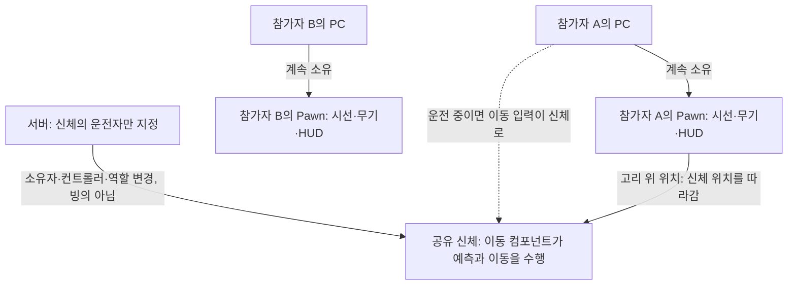

# 04. 공유 신체의 소유권

[← 포트폴리오](../README.md) · 이전: [03 데이터 주도 파츠 빌드](03-data-driven-parts.md) · 다음: [05 방 세이브 보호](05-room-save-protection.md)

**기준일: 2026-11-18. 현재 단계(공유 신체 협동 FPS)의 설계입니다. 구현과 측정이 진행 중이며, 아래 "현재 상태와 미검증 항목"을 함께 읽어 주세요.** 이 문서의 구조는 설계 승인과 일부 스파이크 측정까지 진행되었고, 설계가 목표로 하는 조건을 모두 통과했다는 주장이 아닙니다.

## 게임 규칙

1~4명이 하나의 신체를 공유합니다. 손에 든 무기의 탄창이 비면 조종이 다른 참가자에게 무작위로 넘어갑니다(들고 있던 사람을 뺀 전원이 대상). 기다리는 참가자는 신체 머리 위의 보이지 않는 고리 위에 떠 있는 자기 무기로 계속 사격합니다. 기다리는 총에도 탄창이 있고 자동 장전하며 예비 탄약은 무한이고, 몸으로 넘어가는 총은 남은 탄과 무관하게 탄창이 가득 찬 상태가 됩니다. 교체는 약 0.25초이며 그동안 적 공격에 무적이고, 교체 뒤에는 잠금 시간이 있습니다. 체력은 공유하고, 사망하면 현재 스테이지를 다시 시작합니다. 현재는 2인 최소 통합 단계입니다.

## 문제

여러 참가자가 하나의 몸을 번갈아 조종하되 각자의 시선·무기·HUD는 유지해야 합니다. 조종하는 순간에는 일반 FPS와 같은 이동 예측을 가져야 하는데, 교체는 약 0.25초이고 네트워크 왕복은 100~150ms입니다.

## 제약

- 이동 예측은 유지해야 합니다. 소유 클라이언트가 자기 이동을 먼저 시뮬레이션하고 서버가 확인하는 구조가 이 게임의 이동 감각의 전제입니다([01](01-movement-state-ownership.md)).
- 기존 사격·GAS·HUD 코드는 `PlayerController->GetPawn()`과 플레이어 기반 클래스를 전제하고 있습니다(이 기반 클래스를 직접 참조하는 비시험 파일이 75개). 이 코드를 가능한 한 고치지 않고 재사용해야 합니다.
- 리슨 서버이며, 프로젝트는 엔진의 기본(Generic) 복제를 사용합니다(Iris 미사용, 설정으로 확인).
- 엔진 소스의 사실로 확인한 것: 서버가 조종을 바꾸면 새 조종자가 소유권·역할·컨트롤러를 받는 데 왕복의 절반, 새 조종자의 첫 이동이 서버에 닿는 데 한 왕복, 첫 보정이 오는 데 1.5 왕복이 걸립니다. 이것은 어느 안을 택해도 같으므로, **약 0.25초 안에 인계가 끝난다고 볼 수 없습니다.** 인계 직후의 공백은 별도로 설계해야 합니다.

## 검토한 세 가지 안

| | A안: 교체마다 빙의 변경 | B안: 입력만 서버로 전달 | C안: 참가자는 자기 Pawn을 계속 소유, 서버는 신체의 운전자만 교체 |
|---|---|---|---|
| 활성 참가자의 이동 예측 | 유지(엔진 표준 경로) | **없음** | 유지(같은 CMC 경로) |
| 사격 경로 | 활성일 때 PC의 Pawn이 신체가 되므로 무기·발사 컴포넌트·ASC의 Avatar를 옮기거나 건플레이 코드를 바꿔야 함 | 그대로 | 그대로. 활성·비활성 모두 같은 경로 |
| GAS·체력 | 교체마다 Avatar가 바뀌고 체력 초기화가 덮어씀 → 어차피 신체 체력 분리 필요 | 신체 체력 별도 | 신체 체력 별도. PS의 ASC Avatar는 영구히 참가자 Pawn |
| HUD·입력·카메라 | 교체마다 `GetPawn()`·뷰 타깃·입력 컴포넌트 전환 | 고정 | 고정 |
| 덮어야 하는 엔진 경로 | 문서화된 가상 함수 4개(엔진 재시작이 속도를 0으로 만들고 시선을 신체 회전으로 덮는 부분) | 적음 | 8개. 이 밖에 `GetPawn()`에 걸린 보호 장치가 더 있는지는 **모름** |
| 위험의 크기 | 알 수 있음(목록이 닫혀 있음) | — | **모름** → 스파이크로 판정 |
| 판정 | 대체안으로 보류 | **기각**(이동 예측을 잃음) | **채택(조건부)** |

**C안을 택한 이유는 위험이 작아서가 아니라 재사용 이득이 크기 때문입니다.** 이 게임은 "몸 하나, 시선 여럿"이며, 교체마다 바뀌는 것은 "몸의 운전자" 한 칸뿐이고 참가자의 입력·카메라·무기·능력·HUD는 교체 중에도 그대로여야 합니다. C안은 건플레이·GAS·HUD 쪽을 수정 없이 재사용합니다. 대가는 엔진이 `GetPawn()`에 걸어 둔 보호 장치를 신체가 스스로 다시 구현하는 것입니다. A안은 교체마다 빙의를 바꾸면서 기존 코드의 전제를 바꿔야 해서, C안의 위험이 감당할 수 없는 것으로 판정될 때의 대체안으로 보류했습니다. 설계 초안은 이 "비대칭 상태"(신체의 컨트롤러는 참가자 PC인데 그 PC의 Pawn은 참가자 Pawn)를 엔진이 가정하지 않았다는 점을 명시하고, 이를 판정하는 스파이크와 A안으로 바꾸는 조건을 함께 독립 설계 검토에 올렸습니다.

## 선택한 구조(C안)의 핵심

- **운전자 지정은 빙의가 아닙니다.** 서버가 신체의 소유자·컨트롤러를 운전자 PC로 바꾸고 역할을 정합니다. 신체에는 빙의를 시도하면 거부하고 오류를 남기도록 했습니다.
- **이동 송신 확인 조건을 넘는 방식**: 엔진이 "확인된 Pawn"이 이동 컴포넌트의 소유자일 때만 이동을 보내게 해 둔 조건이 있습니다. 이 값을 영구히 바꾸면 운전자의 마우스 시선이 멈추고 빙의 재확인이 계속 반복됩니다(이 값을 읽는 엔진 코드를 전수 확인). 그래서 엔진의 송신 함수를 호출하는 동안에만 값을 일시 치환하는 범위 가드를 택했습니다. 엔진의 230줄 이동 송신 로직(저장 이동 결합·묶음 전송·타임스탬프)을 복제하지 않기 위해서입니다.
- **서버의 강제 위치 갱신**: 엔진은 이동을 제때 보내지 않는 원격 클라이언트의 Pawn을 서버가 대신 전진시키지만 대상이 PC의 Pawn뿐이라, 신체는 이 보호를 받지 못합니다. 신체의 이동 컴포넌트가 같은 판정으로 스스로 합니다.
- **인계 직후의 공백**: 새 운전자의 첫 이동이 서버에 닿기 전까지 서버의 신체는 멈추지 않고 관성대로 진행합니다. 가속과 제동을 어떻게 처리할지를 세 가지로 비교했습니다. ① 가속 0과 일반 제동 적용 → 이 프로젝트의 지상 제동은 900 → 250cm/s가 약 0.08초에 끝나므로 1 왕복 안에 속도 대부분을 잃어 관성 보존 규칙을 어김. ② 이전 운전자의 마지막 가속을 유지 → 조종권이 넘어간 뒤에도 이전 입력이 신체를 미는 셈이 되어 이전 규칙의 경계를 흐림. ③ **가속 0이되 공백 동안 제동·마찰을 적용하지 않음(순수 관성)** → 입력을 아무에게도 귀속시키지 않고 완료 순간의 속도 벡터를 이어 감. ③을 채택했습니다. 상한은 0.5초(설정값)이고 새 운전자의 확인이 오면 끝납니다.
- **스냅샷과 외삽**: 새 운전자에게 신체의 내부 상태(속도·이동 모드·서버 시각)를 보내고, 받은 쪽은 스냅샷 시각에서 현재 추정 시각까지 같은 관성 규칙으로 신체를 외삽한 상태에서 예측을 시작합니다. 첫 보정의 크기가 시각 추정 오차만큼으로 줄어든다는 설계이며, 외삽 유무를 둘 다 측정하도록 했습니다.
- **인계 완료는 프레임 경계에서 커밋**: 교체 완료와 치명 피해가 같은 순간이면 피해가 먼저입니다. 타이머를 재예약하는 방식은 같은 프레임의 처리 순서가 불확실해서, 만료가 관측된 프레임에는 "완료 대기"만 표시하고 실제 완료는 다음 프레임의 가장 앞(그 프레임의 모든 게임플레이보다 앞)에서 합니다.
- **피해 진입은 하나로**: 플레이어 측 피해 수신자 조회 함수 하나만 거치게 해, 교체 무적과 환경 피해 구분을 그 한 곳에서만 판정합니다. 하나라도 빠지면 신체가 무적이 되거나 참가자 Pawn이 맞는 결함이 생기므로, 적 투사체·시험용 적·디버그·넉백까지 진입점을 전수 목록으로 만들었습니다.
- **고리**: 기다리는 참가자의 무기는 신체 메시를 따라가는 고리 위를 움직입니다. 고리 위 위치는 월드 기준이고 신체가 돌아도 따라 돌지 않아, 신체 회전으로 기다리는 사람의 화면이 휘둘리지 않습니다.

## 검증 계획과 지금까지의 측정

신체 소유권의 스파이크(S1)는 새 파일만 추가하고 기존 파일을 고치지 않는 조건으로 진행했습니다. **판정 항목 12개**와 통과 기준을 먼저 적었습니다. 정상 상태 보정 빈도(원격 운전자, 60초: 대조군의 1.5배 이내), 인계 직후 보정(인계당 2회 이하, 첫 보정 20cm 이내), 속도 보존(인계 없는 대조 주행 대비 5% 이내), 송신 정지 1초, 호스트 운전 시 메시 포즈, 운전자 끊김 재지정, 도착 순서 뒤섞기, 이동 상태(낙하·상승·슬라이드) 인계, 연속 인계, 로그 청결, 참가자 Pawn 불변, 입력 지연 프레임입니다.

대조군은 같은 틀·같은 지연에서 엔진 표준 빙의로 같은 이동 컴포넌트를 조종하는 캐릭터입니다. 지연 환경은 편도 60ms(왕복 약 120ms), 변동 ±15ms, 수신 손실 1%로 모의했습니다.

5·6회차 측정(2026-11-18)의 결과는 이렇습니다.

| 항목 | 결과 |
|---|---|
| 불변 조건(소유권 위반, 이전 운전자 이동의 적용, 끝내 시작 못 함 등) | 다섯 번의 측정에서 모두 0건 |
| 운전자 끊김, 호스트 메시, 입력 지연, 빠른 복귀, 연속 인계, 순서 뒤섞기, 정상 주행 | 통과(정상 주행은 신체 보정 7회 대 대조군 12회) |
| 인계 직후 보정(공중·상승 인계, 37표본) | **미달.** 지상·슬라이드·낙하 인계는 거의 0회이나 일부 공중 인계에서 7~22cm 보정이 4~5회 몰려 발생. 5cm 초과 인계 5회차 3건·6회차 2건, 최댓값 22.4cm·20.3cm |
| 송신 정지 후 수렴 | 6회차 10회 중 2건이 3왕복을 넘음(0.548·0.598초). 대조군 지상에서도 1건. 평균은 대조군의 1.11배. 이전 회차에서는 통과 |

독립 게이트 심사는 이 결과를 이렇게 판정했습니다.

- **감독의 증거 오류를 잡았습니다.** 4회차 보고의 "남은 보정은 3cm 미만"은 첫 보정만 기록되어 있던 시점의 값이었고, 모든 보정을 기록하자 공중 인계 일부에서 7~22cm가 나왔습니다. 심사자의 "증거 부족" 지적이 맞았고 감독의 수치 근거가 틀렸습니다.
- "재측정을 두 번 해도 미달이면 A안으로 전환"이라는 조항을 이번에는 적용하지 않는 것이 정당하다고 보았습니다. 근거는 세 가지입니다. 미달 항목은 인계 공백의 추정 오차에서 나오는데 이 공백은 A안에도 같고 A안은 엔진 재시작이 속도를 0으로 만들어 출발점이 더 나쁩니다. 조항의 취지(C안의 비대칭 연결이 성립하지 않을 때를 거르는 것)에 해당하는 불변 조건은 모두 0건입니다. 두 항목은 재측정 사이에 기준이 두 번 바뀌어 같은 기준으로 두 번 미달한 것이 아닙니다. 단 "조항에서 벗어난 결정"임을 명세에 명시하고, 시도 횟수는 초기화하지 않으며, 끝없는 재측정을 막는 종료 규칙(비교 측정 한 번, 필요하면 근본 수리 한 번과 재측정 한 번, 그 뒤에도 미달이면 A안 전환이 아니라 사용자의 체감 판단)을 둔다는 조건을 붙였습니다.
- **비교 없이는 판정할 수 없다고 보았습니다.** 인계 없는 주행의 기록에는 보정의 횟수만 있고 크기가 없어 "인계가 없는 같은 기동과 같은 수준"인지 로그로 판정할 수 없습니다. 지정된 측정은 대조군과 인계 없는 신체에 같은 기동(같은 속력의 달리기 중 점프)을 30회 이상 수행해, 5cm 초과 보정이 난 기동의 비율이 대조군의 1.5배 이내이고 크기 분포의 상위 5%가 1.5배 이내이며(대조군이 0이면 5% 이하), 별도의 절대 상한(인계 후 1초간 어떤 보정도 50cm 이하)을 지키는지 보는 것입니다. 작은 2cm 보정은 인계가 늘린다는 것도 인정했습니다.
- 시험 설계: 손실과 지터가 실제 시계로 도는 모의에서 "모든 표본이 문턱 이내"는 실행마다 결과가 달라지므로(같은 코드가 4회차에 통과하고 6회차에 실패, 엔진 표준 빙의도 같은 단언을 넘지 못함) 문턱은 다음 실행 전에 고정하고, 분포 단언은 30회 이상으로 늘리고, 절대 상한을 불변 조건으로 남기고, 분포를 재는 시험은 회귀 묶음에서 분리하라는 조건을 붙였습니다.
- **인계 꼬리의 주원인을 로그에서 찾았습니다.** 늦은 인계 다수가 "스냅샷은 4~5프레임에 도착하고 서버 확인은 19프레임에 도착"했습니다. 클라이언트는 80ms 안에 적용했지만 확인 RPC가 서버에 닿는 데 0.2~0.5초가 더 걸린 것입니다. 엔진 표준 빙의도 같은 분포라 구조 차이는 아닙니다. 개선 후보는 확인을 신뢰성 RPC 하나에 걸지 않고 자주 보내는 이동 데이터에 인계 번호를 실어 재전송을 기다리지 않게 하는 것입니다.

## 현재 상태와 미검증 항목

- **현재 상태(2026-11-18)**: 소유권 설계는 독립 설계 검토를 두 차례 거쳐 조건부 통과했고, 스파이크 5·6회차 측정과 게이트 심사까지 끝났습니다. 심사가 지정한 비교 측정은 실행 전이며, 그 결과로 "큰 보정을 키우지 않음" 또는 "키움(근본 수리 후 재측정)"이 정해집니다. 2인 최소 통합(교체 상태 기계, 번호·R·탄창 빔 교체, 잠금, 접속 끊김, 최소 재시작)은 명세 작성과 독립 설계 검토가 진행 중이며, 구현은 스파이크 결과 정리 뒤에 시작합니다.
- **미검증**: 실제 2인 지연 환경에서의 체감, 호스트가 운전자일 때의 일부 항목(자동화 틀에서 만들어지지 않으면 수동 측정으로 옮김), 인계 직후 관성 진행의 감각(지상 달리기 인계 포함), 원격 수신자의 흰색 베리어 연장, 이전 운전자의 되돌림, 교체 중 조준 플래그가 만드는 작은 보정, 4인, 벽 오르기(설계 전).
- **알려진 한계**: 교체가 확정되는 순간 서버에 닿지 않은 이전 운전자의 이동(대략 완료 직전 0.06~0.075초 안에 누른 점프·웅크림)은 버려집니다. 엔진 동작이며 어느 안에서도 같습니다. 인계 직후 약 0.25초 동안 서버는 새 운전자가 보고한 위치를 한정된 범위 안에서 한 번 받아들입니다(벽에 막히지 않고 이동 상태가 같을 때만). 인계 직후의 화면 튐을 줄이기 위한 기술 결정이며 독립 심사를 거쳤습니다.
- **위험(기록)**: 지금까지 찾은 엔진 보호 장치 8개 외에 `GetPawn()`을 전제한 경로가 더 있을 수 있고, 범위 가드 동안 이동 콜백이 `확인된 Pawn`을 읽는 코드가 생기면 깨지며, 엔진 갱신 때 이 목록을 다시 대조해야 합니다. 피해 진입점 통일은 피해 핫패스의 변경이라 별도 심사 범위입니다.
