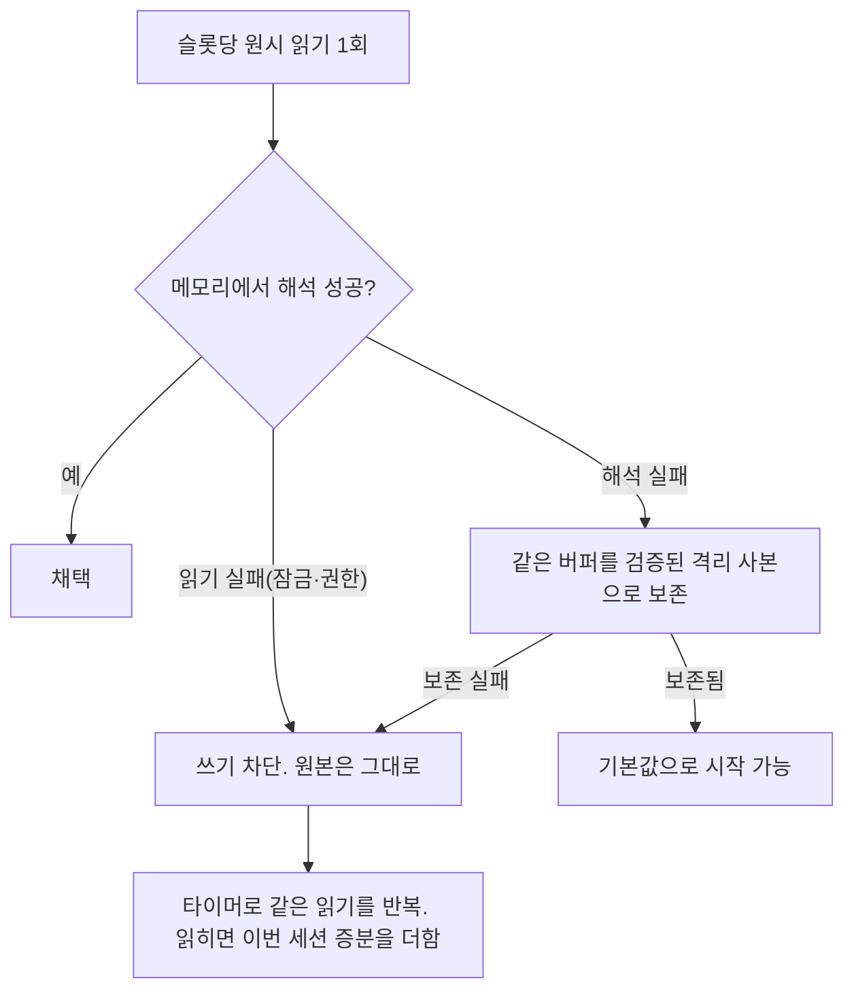

# 05. 방 세이브 보호

[← 포트폴리오](../README.md) · 이전: [04 공유 신체의 소유권](04-shared-body-ownership.md) · 다음: [06 디버깅과 성능 측정](06-debugging-and-measurement.md)

**기준일: 2026-11-18. 이전 단계(협동 스타일 랭크 FPS)에서 만들어 현재 단계로 이어진 설계입니다.** 방 상태(지갑·열린 스테이지·보관 아이템)의 저장 코드는 단계 전환과 무관한 공용 인프라이며, 이후 단계에서도 방 세이브가 건드려지지 않는지가 회귀 확인 항목으로 유지됩니다.

## 문제

저장이 한 번 실패한 뒤의 흐름이 방 상태를 영구히 버리는 결함이었습니다. 순서는 이렇습니다.

1. 실행 직후 방 세이브의 주 파일과 백업 파일을 둘 다 읽지 못합니다. 원인은 파일 잠금·권한(백신 검사, 동기화·백업 도구, 같은 PC의 다른 인스턴스)이거나, 저장 클래스의 이름·모듈이 바뀌어 클래스를 못 찾는 경우(원본 바이트는 멀쩡하고 고친 빌드는 읽을 수 있음)입니다.
2. 읽기에 실패하면 기본값으로 시작합니다.
3. 플레이어가 확정 1회를 하면 저장이 일어나고, 그 사이 잠금이 풀렸다면 **기본값 + 확정분이 주 파일에 성공적으로 쓰이고 백업까지 덮습니다.**
4. 원래 방 전체(지갑·열린 스테이지·모든 플레이어의 보관 카트리지)가 영구히 사라집니다. 화면 안내는 없고 로그 경고 2줄뿐입니다.

두 번째 결함은 지연 재시도였습니다. 저장이 즉시 재시도까지 실패한 뒤에는 거점의 사건(판매·귀환 등)이 있어야만 다시 저장했습니다. 메인 메뉴에 있거나 다른 방에 손님으로 있거나 사건 없이 오래 사냥하는 동안에는 잠금이 풀려도 시도하지 않아, 그 상태로 강제 종료하면 마지막 한 번의 종료 저장만 남습니다.

## 제약

- 화면 안내를 만들지 않는다는 방침(결함은 조용히, 안전하게 처리)
- 세이브 형식을 바꾸지 않음(체크섬·끝 표시 같은 형식 변경은 이번 범위 밖)
- Windows의 파일 공유 모드: 엔진의 세이브 쓰기는 쓰는 중에 읽기가 실패하는 공유 모드로 동작함
- 엔진의 비동기 저장은 작업자 스레드에서 실행되고 완료 콜백은 앱 종료 때 실행되지 않음
- 시험은 사용자의 실제 방 세이브를 읽거나 쓰지 않아야 함

## 선택한 구조

**원칙: 읽지 못한 슬롯에는 절대 쓰지 않고, 쓰기 전에 원본 바이트를 보존한다.**

- **슬롯 읽기는 한 함수**: 원시 읽기 1회 → 결과 4분류(없음 / 읽기 실패 / 0바이트 / 바이트 있음) → 바이트가 있으면 같은 버퍼를 메모리에서 해석. 로드·재읽기·타이머의 재읽기가 모두 이 함수만 씁니다.
- **검증된 격리**: 해석에 실패한 원본 바이트를 별도 이름의 사본으로 쓰고, 되읽어 바이트를 대조합니다. 같으면 "검증됨", 쓰기나 대조가 실패하면 방금 만든 사본을 지우고 "실패"로 처리합니다(엔진 쓰기는 실패해도 반쯤 쓴 파일을 지우지 않기 때문). 이미 같은 바이트의 사본이 있으면 새로 쓰지 않고, 다르면 번호를 올립니다(상한 99). 격리 이름이 원본·보호 이름과 같아지는 입력은 쓰지 않고 실패시킵니다. **원본 슬롯에는 쓰기·삭제를 절대 하지 않는다**가 이 함수의 계약입니다.
- **쓰기 차단 플래그 하나**: "있는 슬롯을 읽지 못했고 원본을 아직 보존하지 못했다"는 하나의 상태로 모든 저장 진입을 막습니다. 이 동안 메모리는 기본값에서 시작한 순수 증분입니다.
- **차단 해소와 병합**: 타이머가 짧은 지연(2초) 뒤, 이후 15초 간격으로 같은 읽기를 다시 합니다. 읽히면 디스크 상태 위에 이번 세션의 증분을 병합합니다(지갑 합, 열린 스테이지는 최댓값, 플레이어 슬롯별 등급 수 합, 고유 카트리지 이어 붙이기). 이 병합이 맞으려면 "차단 중 메모리는 0에서 시작한 증분"이라는 전제가 필요한데, 그 전제를 지키는 장치로 상태 구조체의 리플렉션 필드 수를 검사하는 시험을 두어, 필드가 추가되면 병합 규칙을 정하기 전까지 시험이 깨지게 했습니다.
- **주 슬롯이 읽기 실패이면 백업이 정상이어도 차단**: 백업은 주보다 뒤처질 수 있으므로, 백업을 채택해 저장하면 읽지 못한 주의 더 새 값을 덮기 때문입니다.
- **지연 재시도**: 거점 사건과 무관하게 게임 인스턴스 타이머로 더티인 동안 주기 재시도합니다(메뉴·손님 세계에서도 돌아감). 로그 폭주를 막기 위해 연속 실패 중에는 첫 실패만 오류로 남깁니다.
- **종료 저장이 백업도 갱신**, **백업 쓰기의 실패를 받아 재시도**(주 쓰기는 성공했는데 백업만 실패하는 경우를 아무도 보지 않던 것을 수리).
- 종료 시 해제된 서브시스템에서 콜백이나 타이머가 돌지 않도록 종료 플래그를 모든 콜백의 첫 줄에서 검사합니다.

## 검토한 대안과 기각 이유

| 대안 | 기각 이유 |
|---|---|
| **격리만**(막기·병합 없음) | 잠금(가장 흔한 일시 원인)에서는 원본 바이트를 읽지 못하므로 보존하지 못한 채 덮어씀 |
| 막기만, 병합 없음 | 나중에 읽히면 디스크를 받아들이고 증분을 버려, 가장 흔한 해소 경로(잠금이 풀림)에서 그 세션의 진행이 유실 확정 |
| 못 읽는 동안 "준비 안 됨" 상태로 두고 계속 다시 읽기 | 잠금이 오래가면 스테이지 입장·출구·판매가 화면 안내 없이 닫힌 채 남아 사용자가 이유를 모름. 화면 안내를 만들지 않는 방침과 충돌 |
| 막힌 채 종료하면 증분을 **별도 슬롯**에 쓰고 다음 로드에 더함 | 저장 → 증분 슬롯 삭제 사이에 끊기면 **두 번 더해짐**(지갑·카트리지 복제). 막으려면 순번·식별자가 필요해 세이브 형식 변경 |
| 체크섬·끝 표시(형식 변경) | 부분 손상은 잡지만 이번 결함(못 읽은 파일 덮어쓰기)과 별개. 세이브가 클러스터 크기(4KB)를 넘으면 재검토 |
| 임시 파일 + 교체(원자적 쓰기) | 이득 없음. 주 성공 뒤에만 백업을 쓰는 순서가 이미 같은 보호를 줌. 엔진 이동 API도 원자적이 아님 |

**수리하지 않기로 한 것**: 리셋 대기 중 보스 키·귀환 확정 유실(현재 흐름에서 도달 불가. 대기 중에는 스테이지 입장이 모두 닫힘), 쓰는 중 종료 → 해제된 서브시스템에서 완료 콜백(앱 종료에서는 콜백 자체가 실행되지 않고 에디터 종료에서는 같은 호출 안에서 GC가 수거), 종료 직전 시작된 비동기 쓰기의 완료(쓰기 자체는 끝까지 감, 창은 작은 파일 1회 쓰기 시간인 수 ms). 도달 불가능한 경로에 새 상태를 더하는 것은 비용만 늘리므로 사실로 기록하고 재검토 조건(세션 도중 리셋 경로가 생기거나 대기 중에 열리는 콘텐츠가 생김)을 적었습니다.

## 검증

- **시험 격리가 첫 조건**: 자동 시험은 실제 방 세이브 슬롯을 읽거나 쓰지 않습니다. 시험 전용 슬롯 이름 이음새는 고정 접두사와 화이트리스트로 검증하며(경로 문자·실제 설정 이름과의 충돌 거부), 이 이음새는 개발 자동화 빌드에서만 존재합니다. 실행 전후로 실제 세이브 파일의 이름·크기·수정 시각·해시를 대조했고 **모두 같았습니다**(시험 접두사 파일과 격리 파일은 0개).
- **진짜 읽기 실패를 재현**: 시험 코드가 파일을 배타적으로 잡아(공유 모드 0) 실제 읽기 실패를 만들고, 차단 → 잠금 해소 → 병합(지갑 100 + 증분, 두 번째 호출은 무변화)까지 확인했습니다. 주 슬롯만 잠기고 백업이 정상인 경우(백업을 채택하지 않음), 변경 없이 리셋한 뒤 잠금이 풀리면 원본이 2배로 더해지지 않는 회귀(지갑·보관분이 원본 그대로), 증분과 함께 리셋해도 차단과 증분이 유지되는 경우, 로드 순번이 다르면 병합을 거부하는 경우를 각각 시험했습니다.
- 구현 직후 새 시험 12건이 모두 통과했고, 병합 전 구현 검토의 수리까지 마친 뒤 새 저장 시험 13건을 포함한 거점 루프 묶음 51/51을 통과했습니다. 빌드는 증분과 단독 컴파일로 성공했습니다.
- **독립 설계 검토는 중대 지적 3건**(조건부 통과)을 냈고 재확인에서 닫았습니다. 지적은 세 가지였습니다. 차단 플래그가 "버림" 리셋에서 살아남으면 지갑·카트리지가 두 배로 저장됨, 읽은 바이트를 다시 해석하지 않으면 잠깐 잠겼던 멀쩡한 세이브가 "해석 실패"로 격리되고 기본값이 덮음, "격리 사본이 이미 있을 때"의 결과가 정의되지 않아 어느 쪽이든 유실 또는 영구 차단이 됨. **병합 전 구현 검토**는 중대 0건·주요 2건(격리 실패 로그가 틱마다 오류로 찍히고 상한 도달 경로가 15초마다 기존 사본을 최대 198회 동기 읽기하는 것, 백업 완료 뒤 백업 더티가 타이머 없이 남는 창)을 냈고 좁은 수리와 자체 검증으로 닫았습니다.

## 한계와 남은 일

- **차단된 채 앱을 끄면 그 세션의 증분이 사라집니다.** 권한이 영구히 거부된 환경(읽기 전용 폴더, 읽기까지 막는 랜섬웨어 보호)에서는 매 세션 반복됩니다. 닫으려면 증분 슬롯과 순번(형식 변경)이 필요합니다.
- 주 슬롯 잠금이 오래가면 차단도 오래갑니다. 격리 사본이 상한(99)에 닿으면 더 보존할 수 없어 막히고, 이때는 격리본을 정리하면 풀리도록 안내 문구를 남겼습니다.
- 격리본을 자동으로 되읽는 경로는 없어 클래스 이름 변경을 고친 빌드가 나와도 복구는 수동 절차입니다(수동 복구 절차를 문서화).
- **미검증**: 디스크 가득 참 재현, 정전 때 OS 쓰기 캐시가 두 파일을 함께 잃을 수 있는지(디스크 flush 여부), 패키지 빌드, 2인, 메뉴·손님 세계에서의 타이머 실제 동작(엔진 근거는 있으나 실행 확인은 아님), Windows 외 플랫폼.
