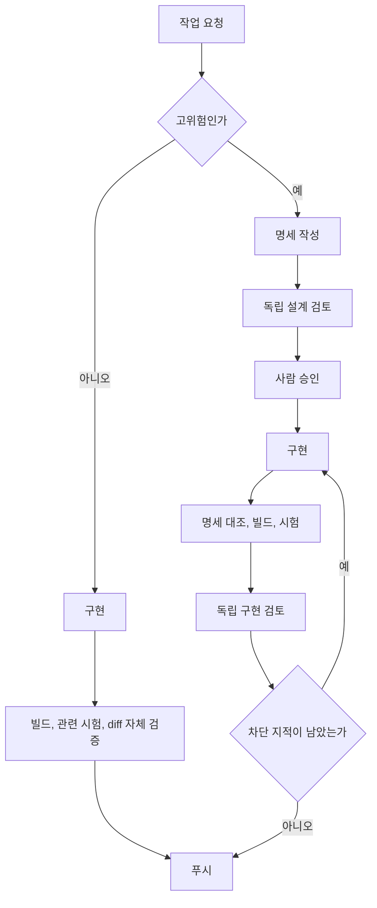

# 07. AI 협업 개발 체계

[← 포트폴리오](../README.md) · 이전: [06 디버깅과 성능 측정](06-debugging-and-measurement.md)

**기준일: 2026-11-18. 이전 단계부터 쓰기 시작해 현재 단계에서도 그대로 운영하는 개발 방식의 설명입니다.** 방향·설계 판단과 검증은 프로젝트 담당자가 맡고, 구현은 AI 코딩 에이전트에 위임합니다. 이 문서는 위임한 결과를 어떻게 믿을 수 있게 만들었는지를 설명합니다. 생산성은 측정 기록이 없어 수치로 주장하지 않습니다.

## 문제

구현을 AI에 위임하면 변경량이 사람이 읽을 수 있는 속도를 넘습니다. 위임하면서도 결과를 믿을 수 있어야 하고, 특히 서버 권위·복제·객체 수명 같은 한 번 틀리면 되돌리기 비싼 변경에서는 작성자와 검증자가 같은 맥락에 묶이면 안 됩니다. 한편 모든 변경에 독립 검토를 붙이면 비용을 감당할 수 없습니다.

## 제약

- 1인 개발이며 검토 모델의 사용량과 시간이 한정되어 있음
- 게임 규칙, 범위 확대, 승인받지 않은 외부 권한은 어떤 모델에도 넘기지 않음
- 모델의 보고는 증거가 아니라 주장

## 선택한 구조

### 1. 모델 3층과 사람의 역할

| 역할 | 맡는 일 | 맡기지 않는 일 |
|---|---|---|
| 프로젝트 담당자(사람) | 게임 규칙·범위·외부 권한 결정, 설계 승인, 통합과 푸시, 체감·외형 판정 | 해당 없음 |
| 감독 | 사용자 지시의 파악, 설계·계획·명세·작업 배정·판정. 긴 조사나 로그 읽기, 실행은 직접 하지 않고 위임 | 게임 규칙·범위의 변경 |
| 주 작업자 | 원인 불명 결함, 여러 시스템에 걸친 판단, 서버 권위·복제 경로의 구현, 에디터 작업 | 명세 밖의 규칙 결정 |
| 하위 작업자 | 명세가 분명한 국지 구현, 반복, 분류, 일괄 처리 | 명세 밖 판단. 멈추고 보고 |
| 독립 검토자 | 고위험 변경의 구현 전 설계 검토와 병합 전 구현 검토. 감독과 다른 별도 인스턴스가 설계 경위 없이 명세와 diff만 받아 적대적으로 검토 | 통과와 기각의 최종 판정 |

이 구조는 이전에 한 모델이 계획과 최종 검증을 모두 맡던 것을 역할별로 나누어 개편한 것입니다. 감독은 설계·계획·명세·배정·판정을 맡고, 긴 조사와 로그 읽기와 실행은 직접 하지 않고 작업자에게 위임합니다.

### 2. 위험도에 따른 독립 검토

되돌리기 비용이 큰 변경(서버 권위·복제·네트워크 경로, 수명주기·소유권·핫패스·공용 계약을 바꾸는 코어 구조)에만 독립 설계 검토와 구현 검토를 적용합니다. 그 밖의 변경은 빌드, 관련 시험, diff 자체 검토로 마칩니다.

**독립성.** 검토자에게는 diff, 검토 지침, 명세만 주고 설계 변호와 토론 이력은 싣지 않습니다. 설계 서술은 전제가 아니라 공격할 안건으로 다루게 하고, 지적에는 코드 인용이나 반증 가능한 실패 시나리오를 요구하며, 지적이 0건이면 본 범위와 안전 근거를 적게 합니다. 지적은 차단·머지 전 수정·후속 가능으로 나누고 차단 지적이 남으면 병합하지 않습니다. 기각에는 근거가 필요하며 근거가 없으면 미해결로 남깁니다.

**운영 판단으로 범위를 줄였습니다.** 독립 검토 모델의 사용량이 감당되지 않아 2026-08-26에 검토를 두 지점으로 줄였고, 2026-09-18에 대상을 고위험 변경으로 좁혔습니다. 이후에는 변경이 실제로 계약·권한·수명·구조를 바꾸는지로 재검토 필요성을 판정합니다. 줄 수가 적다는 이유로 저위험이라고 하지 않고, 코어 파일을 만진다는 이유만으로 자동 재검토를 하지도 않습니다.

### 3. 작업 명세와 인계 규칙

모든 위임 명세에는 구현 담당, 하위 작업자가 스스로 끝내도 되는 범위, 허용 변경과 제외 범위, 완료 조건과 검증, 최종 검토(자체 / 별도 검토 / 필수 독립 검토), 전환 조건과 인계 대상을 적습니다. 하위 작업자는 다음에서 멈추고 상위 작업자에 넘깁니다.

- 명세와 코드가 충돌해 새 설계 판단이 필요함
- 지정 범위 밖의 공용 계약이나 다른 시스템을 고쳐야 함
- 명세에 없는 서버 권한·복제·객체 수명의 변경이 필요함
- 같은 실패를 수정하고 재검증하는 과정을 두 번 거쳤는데 해결되지 않음
- 완료 조건을 검증할 수 없거나 결과가 모호함

인계에는 기준 상태, 현재 diff, 재현 조건, 시도한 수정, 미검증 항목을 담습니다. 같은 파일을 동시에 고치지 않고 다른 작업자의 변경을 되돌리지 않으며, 작업자를 교체해도 실패 횟수·검토 이력·검토 상한은 초기화하지 않습니다.

## 검토한 대안과 기각 이유

| 대안 | 기각 이유 |
|---|---|
| 모든 변경에 독립 검토 | 머지 전 검토 한 번에 14~17분과 16만~56만 토큰이 들어 감당할 수 없음. 운영 중 사용량 한도로 실제로 범위를 줄여야 했음 |
| 작성자가 같은 문맥에서 자체 검토 | 설계 경위가 같은 맥락에 있으면 같은 가정을 반복해서 결함을 놓침 |
| 위임 결과를 보고서로만 확인 | 아래 사례처럼 보고와 실제가 어긋난 일이 있었음 |
| 에이전트 수 제한 없이 병렬화 | 상한 없이 에이전트를 71개까지 늘린 사고(2026-07-15) 뒤 수에 상한을 둠 |

## 검증 규율: 보고는 주장이다

작업자의 완료 보고는 증거가 아니라 주장으로 취급하고 직접 확인합니다.

- **빌드는 로그의 결과 줄로 판정합니다.** 출력을 리다이렉트하면 컴파일 오류로 실패한 빌드가 종료 코드 0으로 보고된 일이 있었습니다(2026-08-17).
- **기존 실패는 기준 커밋과 대조해 분리합니다.** 전체 자동화 약 2천 건 중 112건은 변경 전 커밋에서도 같은 이름으로 실패했습니다. 이름 단위로 대조해 새 실패가 0건임을 확인한 뒤 마감했습니다.
- **시험이 판별하는지 확인합니다.** 게이트를 제거한 변형에서 새 시험이 실패하는지 봅니다.
- **인계 메모의 수식과 기대값은 가설입니다.** 재계산했더니 기대값에 계산 오류가 1건 있었고 제안한 수정의 부작용도 과소 기술되어 있었습니다.
- **권위 경로의 위임 결과는 diff를 전수 대조합니다.** 초기에 하위 모델이 서버 RPC 일부를 빠뜨리고 클라이언트가 값을 넘기는 취약한 구조를 만들고도 "편차 없음"이라고 보고했습니다.
- **체감과 외형은 사람이 PIE로 확인합니다.** AI가 정지 캡처로 "적이 걷는다"고 판정했으나 실제로는 걷는 동작 없이 미끄러졌습니다. 이후 동작과 외형 판정은 담당자 몫으로 두었습니다.
- **미검증은 미검증으로 남깁니다.** 실행 검증이 막히면 후속 설계와 코드 변경을 끝없이 쌓지 않고 막힌 사유와 남은 검증을 구분해 보고합니다.

## 기록이 다음 판단의 입력이 되는 구조

결정 로그 258건, 구조 결정 문서 54건(2026-11-14 기준)을 남겼습니다. 새 계획 전에 이 기록을 먼저 조회하고, 기록에 답이 있는 질문은 다시 묻지 않으며, 기록이 코드와 어긋나면 코드를 확인하고 어긋남을 보고합니다. 비자명한 설계는 질문을 한 번에 하나씩 추천 답과 함께 토론하고 처음 의도, 결론, 기각안, 재검토 조건을 남깁니다. 작업 보드는 클레임 없이 착수하지 않고, 진행 중인 행과 수정 경로가 겹치는지 확인합니다. 완료 시에는 증거와 남은 위험을 함께 기록합니다.

## 검토가 결과를 바꾼 사례

| 변경 | 검토 단계 | 지적 | 결과 |
|---|---|---|---|
| 멀티 진입 시 구역 색 깜빡임 수정(복제 값의 최초 커밋 시점) | 설계 검토 조건부 통과, 구현 검토 통과 | 목표와 비목표가 모순됨. 명세가 전제한 시작 구역 카운트다운이 코드에 없음 | 목표를 "런 시작 확정 시점의 색 변화 0"으로 정정. 구현 검토 소지적 4건 중 3건 수용 |
| 적 흐름장 시야 직진(스웜 핫패스) | 설계 검토 3회차 통과, 구현 검토 | 초기 설계 세 가지가 줄 수렴을 만들어 철회, 이웃 연쇄 시야 판정은 반례로 수정. 구현 검토에서 비용 상한이 거리(cm)라 맵 해상도에 따라 늘고 설정 파일로 우회됨 | 반경을 코드에서 25셀로 제한. 기준선 미실행 지적은 근거를 대고 기각 |
| 원격 투사체 비행 모사(복제 경로) | 설계 검토 조건부 통과, 구현 검토 | 설계 검토에서 중대 지적: 기존 순간이동 판정 휴리스틱이 클라이언트 외삽과 양립하지 않아 지터마다 비행이 재시작됨 | 복제 비행 번호로 판정하는 설계로 변경. 구현 검토에서 중대·주요 지적 없음 |
| 무기 보상 미션(서버 보상 경로) | 구현 검토(사용량 한도로 별도 인스턴스가 대체) | 보상이 처치 지점 아래 지붕 위에 떨어져 도달할 수 없음. 표적이 네트워크 컬 거리 밖에서 손님에게 사라짐 | 처치 지점 아래 가장 낮은 걷기 가능 바닥을 탐색하게 하고 표적을 항상 관련 액터로 지정 |
| 다운 관전 1인칭(복제 경로) | 설계 검토 조건부 통과, 구현 검토 | 리슨 호스트가 관전할 때 대상의 1인칭 시각 액터가 복제되면 안 됨 | 눈 리그 아래에서만 허용하는 검증 추가 |
| 방 세이브 보호([05](05-room-save-protection.md)) | 설계 검토 조건부 통과(중대 3), 구현 검토 조건부 통과(주요 2) | 차단 플래그가 리셋에서 살아남으면 지갑이 두 배로 저장됨 등 | 플래그 통합, 읽기 함수 단일화, 격리 계약 정의. 구현 검토 지적은 좁은 수리로 닫음 |
| 공유 신체 인계 측정([04](04-shared-body-ownership.md)) | 독립 게이트 심사 | 감독의 보고 수치("남은 보정 3cm 미만")가 첫 보정만 본 값이었음. "대조군의 최댓값의 1.5배 이내" 기준은 표본 하나에 좌우됨 | 비교 측정(30회 이상, 비율과 상위 5%, 절대 상한)과 종료 규칙, 문턱 사전 고정으로 판정 방식을 고침 |

마지막 사례는 감독이 낸 판정안의 오류를 독립 검토자가 잡은 경우입니다. 이 체계는 작업자뿐 아니라 감독도 검증 대상으로 둡니다.

## 한계와 남은 일

- **AI 작업자의 결함이 사람의 PIE에서 잡히기도 했습니다.** 호스트가 손님을 관전할 때 무기가 붙지 않았고 원인은 리슨 호스트에서 소유 클라이언트 호출이 흡수되는 엔진 동작이었으며, 자동 시험과 구현 검토를 통과한 뒤 드러났습니다. 내비 메시가 없는 맵에서 걷는 보스가 움직이지 않는 결함도 PIE에서 찾아 비행 추적으로 바꾸었습니다.
- **독립 검토는 비용이 큽니다.** 사용량 한도로 범위를 줄여야 했고, 줄인 범위 밖의 결함은 자체 검증과 사람의 확인에 의존합니다.
- **게이트가 닫지 못하는 틈이 있습니다.** 설계 검토와 구현 검토 사이의 구현 중 설계 결정은 검토를 거치지 않으므로 그 목록을 구현 검토에 사실로 넘깁니다. 지적 0건은 통과 근거로 쓰지 않았습니다.
- **사람이 해야 하는 일이 남습니다.** 체감 튜닝, 외형 판정, 범위와 게임 규칙 결정은 자동 검증으로 대체되지 않습니다.
- 4인 협동과 장시간 실행은 아직 기록이 없습니다.
