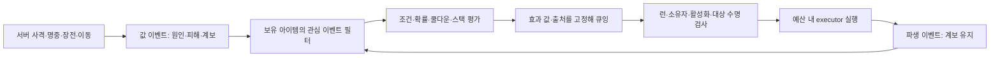

# 사례 04 · 이벤트 기반 빌드와 안전한 연쇄 효과

[← 포트폴리오](../README.md) · [검증 범위](05-verification.md)

## 문제: 명중 하나가 여러 효과와 처치를 만들 수 있다

명중 탄창 회복, 처치 폭발, 흡혈과 Status가 서로 연결되면 직접 사격·파생 피해·처치의 출처를 구분해야 합니다. 단순히 데미지 함수에서 모든 아이템을 다시 호출하면 자기 재발동과 무한 연쇄가 생깁니다. 지연 실행 중 적이 풀에서 재사용되거나 아이템이 제거될 수도 있습니다.

기존 Combat Item 기반은 이벤트 평가와 효과 실행을 분리합니다. 최신 12종 승인 목록의 수치·동작 보강은 별도 진행중이며 전체 콘텐츠 연결·실행 완료로 소개하지 않습니다.

## 평가와 실행을 분리한다

관심 이벤트 마스크와 런타임 캐시로 관련 없는 규칙 평가를 줄입니다. 큐에는 결과 계산에 필요한 값과 원인 스냅샷을 담습니다. 지연 실행 때 현재 무기의 값을 무조건 다시 읽으면 발사 후 교체한 다른 무기의 성능이 과거 공격에 섞일 수 있기 때문입니다.

## 연쇄 깊이와 자기 재발동

직접 행동은 G0이고 별도 파생 공격은 G1, 다음 파생은 G2까지입니다. 같은 효과가 자신의 산출을 다시 원인으로 삼지 않도록 출처를 추적합니다. 일반 아이템은 직접 행동을 기본 대상으로 하고 파생 호환은 명시적으로 다룹니다. 원래 공격만 수정하는 Perk와 추가 타격·투사체를 만드는 Perk도 구분합니다.

세대 제한은 폭주의 한 축만 해결합니다. 소유자별 큐 깊이·발동률과 프레임 작업 예산이 별도로 필요합니다. 기존 회복 효과에는 일반 공격 효과와 분리된 유계 큐와 병합 조건이 있습니다. 포화로 효과가 거절되는 경로도 기록하며 무한한 회복 보장을 주장하지 않습니다.

## 액터 유효성과 같은 생명은 다르다

적 액터가 파괴되지 않고 풀로 돌아왔다면 weak 참조는 여전히 유효할 수 있습니다. 따라서 대상 참조에 LifeSerial을 함께 기록해 같은 활성 수명인지 확인합니다. 아이템 제거·재획득도 활성화 식별과 런타임 epoch로 구분하여 예전 요청이 새 소유 상태에 적용되지 않게 합니다.

## 피해 의미와 스택을 분리한다

흡혈은 직접 무기가 실제로 감소시킨 적 HP를 기준으로 하며 실드·오버킬·DoT·아이템 추가 타격으로 보상을 부풀리지 않습니다. 최신 폭발·번개·화상 계약은 방어 전 공격값과 방어 후·HP 제한 전 처치값을 용도별로 구분하도록 보강합니다.

Combat Item 보유 수량은 효과 강도를 정하고 Status의 축적은 대상 상태 체계가 관리합니다. 아이템 3개가 곧 DoT 3스택은 아닙니다. Slow·DoT·방어 감소는 기존 경량 일반 적 상태와 GAS 특수 대상의 경계를 유지합니다.

최신 처치 폭발은 폭발 시점의 전체 대상 스냅샷을 예산에 따라 분산 처리하는 승인 설계입니다. 기존 최대 대상 수를 삭제한 것만으로 완료하지 않습니다. 메모리·지연·포화·풀 재사용 검증이 남아 있습니다. 번개의 지형 차폐·화상 갱신 보강도 지원 코드와 실제 효과 연결을 구분합니다.
