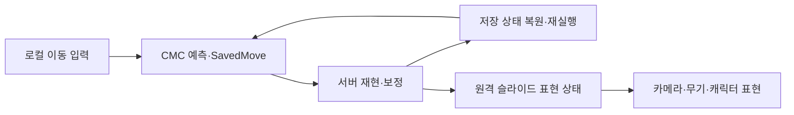

# 사례 05 · 예측 이동과 협동 UI의 책임 분리

[← 포트폴리오](../README.md) · [현재 상태](08-current-state.md)

## 움직임은 서버에서도 재현되어야 한다

빠른 슬라이드·공중 제어는 입력에 즉시 반응해야 하지만 협동 위치 판정은 서버와 일치해야 합니다. 프로젝트는 엔진 CharacterMovementComponent를 확장하고 SavedMove에 슬라이드 경과·진입 속도·쿨다운·경사 누적 등을 저장·복원합니다. 보정 뒤 시뮬레이션을 재실행할 때 과거 상태가 필요하기 때문입니다.

슬라이드 진입은 속도 임계와 쿨다운을 검사합니다. 진입 속도를 기록하고 커브·경사 영향을 적용하며 최소 속도와 시간에 따라 종료합니다. 이동 입력의 방향 전환과 속도 계산은 예측 경로 안에서 처리합니다. 원격 프록시에는 슬라이드 표현 상태와 일련번호를 전달하여 시각 효과를 조정합니다.

설계상 Sprint/Dash/Parkour는 없습니다. 기본 점프는 한 번이고 추가 공중 점프는 Combat Item입니다. 기존 이동 구현의 공중 점프 지원과 현재 콘텐츠의 기본 점프 정렬은 별도 확인 대상입니다. 이동 코드 지원만으로 해당 아이템의 획득·제거 이력까지 검증됐다고 쓰지 않습니다.

## 로비 미리보기와 확정 상태

캐릭터 탐색 미리보기는 로컬 화면의 책임입니다. 준비 확정·취소와 확정 캐릭터는 기존 서버 선택 계약을 사용합니다. 다른 플레이어에게 미확정 탐색을 계속 방송하지 않고 확정 후 초상·준비를 표시합니다. 런 도중 빌드 정보도 서버 무기·개인 상태의 표시이며 UI가 판정 정본은 아닙니다.

UI는 CommonUI 기반과 기존 세션·트래블 계약을 재사용합니다. 화면 스타일 자산·폰트·외부 UI 팩의 제작은 프로젝트 성과로 주장하지 않습니다. 프로젝트의 작업은 입력·포커스·데이터 연결·준비 상태·화면 흐름과 기존 판정의 경계를 유지하는 부분입니다.

기존 기록에는 실제 2인 로비→런, 준비 확정·취소, 설정 복귀, 사격·장전과 Downed·관전·근접 부활 확인이 있습니다. 전체 HUD·4인·추가 화면비·패키지 렌더링 검증은 남았습니다.

## 저작 도구도 게임플레이 계약을 지킨다

무기 외형 저작은 기본 수치·WSU·발사 판정과 분리합니다. 공유 원본을 보호하고 대상 DataAsset의 외형 참조만 비교하며 지정 패키지를 저장한 뒤 다시 로드해 확인합니다. BP 컴파일·메시/재질/소켓·장전 참조 검사는 저작 실수를 일찍 드러냅니다.

다만 기술 연결이 성공해도 손 접촉·ADS·장전 취소·멀티플레이 3인칭 표현은 실제 플레이 확인이 필요합니다. 에디터 검증은 사용자 형상 확인이나 최종 건플레이 검증을 대신하지 않습니다. GL 전용 리그·장전·ADS 같은 지원 공백도 명시적으로 남겨 둡니다.
