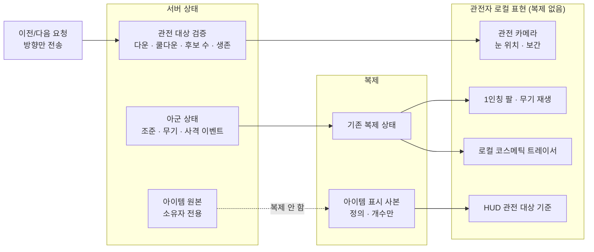

# 사례 07 · 다운 관전과 원격 표현: 복제하지 않는 1인칭 화면

[← 포트폴리오](../README.md) · [예측 이동·UI](09-movement-lobby-ui.md)

## 문제: 쓰러진 뒤에도 아군의 전투를 같은 시점으로 보고 싶다

협동에서 쓰러진 플레이어는 부활을 기다리는 동안 아군을 관전합니다. 처음 구현(2026-10-22)은 서버가 아군 폰을 시점 대상으로 지정하고, 내 컴퓨터에서는 제한 회전 3인칭 관전 카메라가 그 지시를 받는 구조였습니다. 사용자 실행 확인에서 두 가지가 문제로 나왔습니다. 아군의 손·무기·사격이 보이지 않았고, HUD에는 관전 대상이 아니라 내 코인·아이템이 표시되었습니다.

원인은 엔진 기본 동작에 있었습니다. 시점 대상이 아군 폰이 되면 엔진은 그 아군을 시점 소유자로 취급하여, 소유자에게 숨기는 3인칭 몸과 무기를 관전자에게도 숨깁니다. 1인칭 팔·무기는 설계상 소유자 컴퓨터에서만 그리는 로컬 표현이었습니다. HUD는 로컬 플레이어 기준으로 고정되어 있었습니다.

이어서 사용자가 아군 1인칭 관전을 요청하여 이를 결정(DL-177)으로 바꾸었습니다. 이 요청은 "1인칭 연출은 소유자 로컬 전용"이라는 기존 구조 결정(ADR 0022)의 예외를 여는 일이어서, 복제와 서버 권위를 늘리지 않는 방법이 핵심 과제가 되었습니다.

## 프로젝트의 선택

| 선택 | 내용 | 이유 |
| --- | --- | --- |
| 서버는 대상 유효성만 판정 | 이전/다음 전환 요청은 클라이언트가 방향만 보내고, 서버가 다운 상태·쿨다운·후보 수·대상 생존을 검사합니다. 고른 대상은 살아 있는 동안 유지하고 자동 재선택은 대상이 무효일 때만 합니다. | 클라이언트가 임의 대상을 지정하지 못하게 하고, 판정은 서버 한 곳에 둡니다. |
| 1인칭 연출은 복제하지 않음 | 관전자 컴퓨터가 이미 복제되는 아군의 상태(조준 방향, 무기, 사격 이벤트)로 팔·무기·자세를 로컬에서 재생합니다. 1인칭 시각 액터는 복제하지 않는다는 검사를 넣었습니다. | 관전자 수가 늘어도 네트워크 비용이 늘지 않습니다. |
| 표시 사본만 복제 | 팀원 아이템 박스와 관전 HUD를 위해 아이템 정의와 개수만 담은 표시용 사본을 전원에게 복제하고, 서버 검증에 쓰는 원본은 소유자 전용으로 유지합니다. | 원본의 부수 효과와 검증 핸들을 노출하지 않습니다. |
| HUD는 관전 대상 기준 | 코인·무기·탄약·아이템·체력은 관전 대상 값을 읽는 단일 해석 지점을 거치고, 무기 성장 상세·상호작용은 본인 기준을 유지합니다. | 화면마다 분기를 흩뿌리지 않고 한 곳에서 "누구의 정보인가"를 정합니다. |

3인칭 관전 카메라는 설정 하나로 되돌릴 수 있게 남겨 두었습니다.

## 엔진 기본 동작과 어긋난 지점

원격 컴퓨터에서 다른 플레이어의 1인칭을 재생하려고 하자 "직접 조종 중일 때만 동작한다"는 전제가 카메라·애니메이션·무기·탄 표현 여러 층에 들어 있었습니다. 조건 하나를 바꾸는 것으로 끝나지 않았고, 사용자 실행 확인을 거치며 층별로 찾았습니다.

| 증상 | 원인 | 처리 |
| --- | --- | --- |
| 관전 카메라 위치가 갱신되지 않음 | 카메라 매니저는 시점 대상이 카메라 액터이면 그 컴포넌트를 직접 읽고 카메라 계산 함수를 부르지 않습니다. 폰이 시점 대상일 때만 불립니다. | 카메라 위치 계산을 매 프레임 갱신 단계로 옮겼습니다. |
| 팔·무기가 보이지 않고 손 위치가 눈 위 약 1.5m에 있음 | 1인칭 애니메이션 블루프린트가 "로컬 조종 중"일 때만 절차 자세 계산을 실행했습니다. 계산이 빠지니 자세 값이 0이었습니다. | 조건을 "1인칭 표현이 활성(소유자 또는 관전 중)"으로 바꿨습니다. 2인 PIE에서 뼈 위치를 직접 읽어 눈 기준 위치가 소유자 자세와 같아진 것을 확인했습니다. |
| 호스트가 손님을 관전할 때 무기가 붙지 않음 | 무기 블루프린트의 초기화 이벤트가 "소유 클라이언트에서 실행" RPC였습니다. 리슨 서버 호스트에서는 원격 소유이고 비복제인 액터의 이 호출이 흡수됩니다. | 이벤트를 비복제로 바꾸었습니다. 에디터 자동화 도구로는 이 복제 플래그를 바꿀 수 없어 사용자가 직접 수정했습니다. |
| 관전자에게 아군 탄이 보이지 않음 | 시점 대상의 소유 탄은 "소유자에게 숨김" 설정이어서 관전자에게도 숨겨졌습니다. | 관전 중에는 확정된 사격마다 관전자 쪽에서 로컬 트레이서를 그립니다. 실제 투사체는 복제와 판정을 그대로 둡니다. |
| 관전 중 팀원 목록에 관전 대상이 풀피로 중복 | 팀원 줄과 다운 마커가 로컬 플레이어 기준이었습니다. | HUD가 보는 플레이어를 기준으로 바꾸어 관전 대상은 목록에서 빠지고 다운된 로컬 플레이어가 팀원으로 표시됩니다. |

## 독립 심사 지적 수리

고위험 변경으로 분류하여 계획과 병합 전에 독립 심사를 두 번 받았습니다(기록상 최종 심사에서 치명 지적 없음). 이 중 반영한 지적은 다음과 같습니다.

- 호스트가 관전할 때 관전 대상의 1인칭 시각 액터가 복제되면 안 되므로, 눈 리그 아래만 허용하는 검증을 추가했습니다.
- 관전이 끝난 뒤 눈 리그 오프셋을 해제하고, 부모 스케일 영향을 되돌렸습니다.
- 부활 구조자 동률 처리 규칙을 서버와 같게 맞췄습니다.
- 플레이어 상태가 도착하기 전에는 관전 라우팅을 보류하고, 다운 중 스스로 다시 켜지는 위젯을 다시 접도록 했습니다.

## 원격 표현의 같은 문제: 아군 투사체

아군이 쏜 투사체 트레일이 멀티에서 휘어 보이던 문제도 같은 계열입니다(PROJ-NETSIM, 2026-10-22). 원격 클라이언트의 복제 투사체가 위치 갱신마다 순간이동하여, 리본이 지그재그 점열을 곡선으로 이었습니다. 서버 판정은 건드리지 않고, 원격 클라이언트에서는 비행을 충돌 없이 로컬 보간으로 모사하며 중력 배율과 비행 번호만 복제하도록 바꾸었습니다. 비행 번호는 새 발사와 위치 지터를 결정적으로 구분하기 위한 값입니다. 심사에서 기존 순간이동 휴리스틱이 클라이언트 외삽과 양립하지 않는다는 지적이 나와 이 방식으로 바뀌었습니다.

## 검증 범위

| 구분 | 내용 |
| --- | --- |
| 확인됨 | 에디터 빌드 성공. 관전, 표현 활성 판정, HUD 대상 결정, 표시 사본, 투사체 분류 관련 자동 시험 통과(기록 기준). 사용자 PIE로 1인칭 관전 전 항목, 호스트가 손님을 관전하는 경우의 무기 부착, 아군 트레일 가시성, 2인+지연 시뮬레이션 확인 |
| 남음 | 부활 직후 재다운 시 손님의 관전 전환이 10초 안에 이뤄지지 않은 1회는 원인을 확인하지 못했습니다. 3~4인 관전, 관전 대상 전환 중 대상 사망 같은 경계 상황, 패키지 빌드의 별도 검증은 기록에 없습니다. 투사체 모사의 일시정지 중 보간 보정 지속 등 낮은 우선순위 지적은 남겨 두었습니다. 사용자 실행 환경 밖의 네트워크 품질 수치는 이 문서에 쓰지 않습니다. |

기록의 기존 실패 시험 9건은 변경 전 기준에서도 동일하게 실패하여 이 작업의 결과와 분리했습니다.
