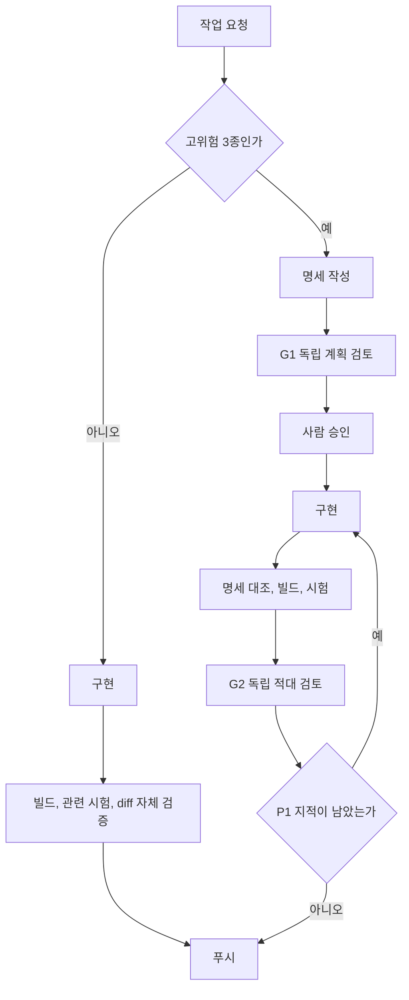

# AI 협업 개발 프로세스: 구현은 위임하고 판단과 검증은 책임진다

[← 포트폴리오](../README.md) · [검증 근거](05-verification.md)

**기준일: 2026-10-23.** 2026-05-28 첫 커밋 이후 커밋 2,691개 중 구현의 상당 부분을 AI 에이전트가 맡았습니다. 이 문서는 그 결과물을 어떻게 통제하고 검증했는지 설명합니다. 생산성은 측정 기록이 없어 수치로 주장하지 않습니다. 비공개 명세, 결정 기록, 작업 기록을 읽어 정리했습니다.

## 1. 역할 분담

| 역할 | 사용 모델 | 책임 | 맡기지 않은 것 |
|---|---|---|---|
| 프로젝트 담당자(사람) | 없음 | 게임 규칙, 범위, 외부 권한 결정. 설계 승인. 통합과 푸시. 체감과 외형 판정 | 해당 없음 |
| 계획·최종 검증 모델 | Opus | 조사, 명세 작성, 위험 분류, 구현 결과와 명세의 전수 대조, 빌드와 시험 판정 | 게임 규칙과 범위의 변경 |
| 구현 모델 | Sonnet. Codex 환경에서는 별도 구현 모델 | 명세 범위 안의 구현과 허용된 자체 검증 | 명세 밖 판단. 멈추고 보고합니다 |
| 독립 검토 모델 | Fable. 일부 작업은 별도 Opus 인스턴스 | 계획과 머지 전 diff의 적대적 검토, 지적 제출 | 통과와 기각의 최종 판정 |

게임 규칙, 범위 확대, 승인받지 않은 외부 권한은 어떤 모델에도 넘기지 않았습니다.

## 2. 위험도에 따른 게이트

모든 변경에 독립 검토를 붙이면 비용을 감당할 수 없어, 되돌리기 비용이 큰 **고위험 3종**에만 계획 검토(G1)와 머지 전 적대 검토(G2)를 적용했습니다. 서버 권위·복제·네트워크 경로의 변경, 스웜 핫패스(스폰, 흐름장, 적 틱)의 구조 변경, 수명주기·소유권·GAS 적용 범위를 바꾸는 코어 구조 변경입니다.

**독립성.** 설계자와 검증자를 분리했습니다. 검토 모델에는 diff, 검토 지침, 명세만 주고 설계 변호와 토론 이력은 싣지 않았습니다. 프로젝트 지침과 커밋 메시지에 섞인 설계 근거까지 막을 수는 없어서, 지침에 "설계 서술은 전제가 아니라 공격할 안건"이라는 규칙을 두었습니다. 지적에는 코드 인용이나 반증 가능한 실패 시나리오가 필요하며, 지적이 0건이면 본 범위와 안전 근거를 적게 했습니다. 지적은 P1(머지 차단), P2(머지 전 수정), P3(후속 가능)로 나누고 P1이 남으면 푸시하지 않습니다. 기각에는 근거가 필요하며 근거가 없으면 미해결로 남깁니다.

**운영 판단.** 독립 검토 모델의 사용량이 감당되지 않아 2026-08-26에 검토를 두 지점으로 줄였고, 2026-09-18에 대상을 고위험 3종으로 좁혔습니다. 그 밖의 변경은 빌드, 관련 시험, diff 자체 검토로 마칩니다.

## 3. 작업 명세와 인계 규칙

명세에는 구현 담당, 구현 모델의 자체 완료 범위, 허용 변경과 제외 범위, 완료 조건과 검증, 최종 검토(자체, 별도 검토, 필수 게이트 중 하나), 전환 조건, 인계 대상을 적습니다. 구현 모델은 다음 상황에서 멈추고 상위 모델에 넘깁니다.

- 명세와 코드가 충돌해 새 설계 판단이 필요합니다.
- 지정 범위 밖의 공용 계약이나 다른 시스템을 고쳐야 합니다.
- 명세에 없는 서버 권한, 복제, 객체 수명의 변경이 필요합니다.
- 같은 실패를 수정하고 재검증하는 과정을 두 번 거쳤는데 해결되지 않았습니다.
- 완료 조건을 검증할 수 없거나 결과가 모호합니다.

인계에는 기준 상태, 현재 diff, 재현 조건, 시도한 수정, 미검증 항목을 담습니다. 같은 파일을 동시에 고치지 않고, 다른 작업자의 변경을 되돌리지 않으며, 파일을 지정해 자기 변경만 커밋합니다.

## 4. 보고는 주장이다: 검증 규율

작업자의 완료 보고는 증거가 아니라 주장으로 취급하고 직접 확인합니다.

- **빌드는 로그의 `Result:` 줄로 판정합니다.** 출력을 리다이렉트하면 컴파일 오류로 실패한 빌드가 종료 코드 0으로 보고된 일이 있었습니다(2026-08-17).
- **기존 실패는 기준 커밋과 대조해 분리합니다.** 전체 자동화 약 2천 건 중 112건은 변경 전 커밋에서도 같은 이름으로 실패했습니다. 이름 단위로 대조해 새 실패가 0건임을 확인한 뒤 마감했습니다.
- **시험이 판별하는지 확인합니다.** 게이트를 제거한 변형에서 새 시험이 실패하는지 봅니다.
- **인계 메모의 수식과 기대값은 가설입니다.** 재계산했더니(2026-09-13) 기대값에 계산 오류가 1건 있었고 제안한 수정의 부작용도 과소 기술되어 있었습니다.
- **권위 경로의 위임 결과는 diff를 전수 대조합니다.** 초기에 하위 모델이 서버 RPC 일부를 빠뜨리고 클라이언트가 값을 넘기는 취약한 구조를 만들고도 "편차 없음"이라고 보고했습니다.
- **체감과 외형은 사람이 PIE로 확인합니다.** AI가 정지 캡처로 "적이 걷는다"고 판정했으나 실제로는 걷는 동작 없이 미끄러졌습니다. 이후 동작과 외형 판정은 담당자 몫으로 두었습니다.

## 5. 기록이 다음 판단의 입력이 되는 구조

결정 로그 190건, 구조 결정 문서(ADR) 48건, 설계 토론 기록 129건, 구현 명세 260여 건을 남겼습니다. 새 계획 전에 이 기록을 먼저 조회하고, 기록에 답이 있는 질문은 다시 묻지 않으며, 기록이 코드와 어긋나면 코드를 확인하고 보고합니다. 비자명한 설계는 질문을 한 번에 하나씩 추천 답과 함께 토론하고 처음 의도, 결론, 기각안을 남깁니다.

작업 보드는 클레임 없이 착수하지 않고, 진행 중인 행과 수정 경로가 겹치는지 확인한 뒤 담당을 적습니다. 끝나면 완료 커밋 해시와 로그를 남깁니다. 문제 해결 문서에는 증상, 원인, 해결 순서로 실제로 겪은 것만 적습니다.

## 6. 게이트가 결과를 바꾼 사례

| 변경 | 검토 단계 | 지적 | 반영 결과 |
|---|---|---|---|
| 구역 초기 상태 동기화(ZONE-INIT-SYNC), 복제 값의 최초 커밋 시점 | G1 조건부 통과, G2 푸시 가능 | G1 P2: 목표와 비목표가 모순됩니다. 명세가 전제한 시작 구역 카운트다운이 코드에 없습니다 | 목표를 "런 시작 확정 시점의 색 변화 0"으로 정정했습니다. G2의 P3 4건 중 3건을 수용했습니다 |
| 적 흐름장 시야 직진(FLOW-SPREAD-1), 스웜 핫패스 | G1 3회차 통과, G2 | G1: 초기 설계 세 가지가 8줄 수렴이나 중앙 한 줄 수렴을 만들어 철회했고, 이웃 연쇄 시야 판정은 반례로 수정했습니다. G2 P2: 비용 상한이 거리(cm)라 맵 해상도에 따라 늘고 설정 파일로 우회됩니다 | 반경을 코드에서 25셀로 제한했습니다. 기준선 미실행 지적은 근거를 대고 기각했습니다 |
| 원격 투사체 비행 모사(PROJ-NETSIM), 복제 경로 | G1 조건부 통과, G2 | G1 P1: 기존 순간이동 판정 휴리스틱이 클라이언트 외삽과 양립하지 않아 지터마다 비행이 재시작됩니다 | 복제 비행 번호로 판정하는 설계로 바꾸었습니다. G2에서 P1과 P2는 없었습니다 |
| 무기 보상 미션(ECON-DROP S3), 서버 보상 경로 | G2. 모델 사용 한도 때문에 사용자 승인으로 별도 Opus 인스턴스가 대체 | P2: 보상이 처치 지점 아래 지붕 위에 떨어져 도달할 수 없습니다. P2: 표적이 네트워크 컬 거리 밖에서 손님에게 사라집니다 | 처치 지점 아래 가장 낮은 걷기 가능 바닥을 탐색하게 했고 표적을 항상 관련 액터로 지정했습니다 |
| 다운 관전 1인칭(SPECTATE-1P), 복제 경로 | G1 조건부 통과, G2 | G2 P2: 리슨 호스트가 관전할 때 대상의 1인칭 시각 액터가 복제되면 안 됩니다 | 눈 리그 아래에서만 허용하는 검증을 추가했습니다. P1은 없었습니다 |
| 로비 연습 자판기(LOBBY-VEND), 게이트 없는 작업 | 감독 검토 | 로비 캐릭터의 새 복제 값이 Push Model을 쓰지 않았습니다 | Push Model로 바꾸고 재빌드와 시험을 통과했습니다 |

## 7. 한계와 솔직한 평가

- **AI 작업자의 결함이 사람의 PIE에서 잡혔습니다.** 호스트가 손님을 관전할 때 무기가 붙지 않았고, 리슨 호스트에서 소유 클라이언트 호출이 흡수되는 엔진 동작이 원인이었습니다. 자동 시험과 G2를 통과한 뒤 드러났습니다. 내비 메시가 없는 맵에서 걷는 보스가 움직이지 않는 결함도 PIE에서 발견해 비행 추적으로 바꾸었습니다.
- **게이트는 비용이 큽니다.** 머지 전 검토 한 번에 14~17분과 16만~56만 토큰이 들었습니다. 상한 없이 에이전트를 71개까지 늘린 사고(2026-07-15) 뒤로 에이전트 수에 상한을 두었습니다.
- **게이트가 닫지 못하는 틈이 있습니다.** G1과 G2 사이의 구현 중 설계 결정은 검토를 거치지 않으므로 그 목록을 G2에 사실로 넘겼습니다. 지적 0건은 통과 근거로 쓰지 않았습니다.
- **사람이 해야만 하는 일이 남습니다.** 체감 튜닝, 외형 판정, 범위와 게임 규칙 결정은 자동 검증으로 대체되지 않습니다. 4인 협동과 장시간 실행은 아직 기록이 없습니다.
